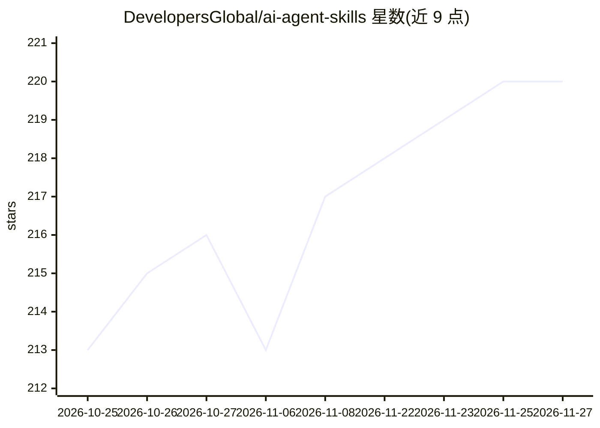

# DevelopersGlobal/ai-agent-skills

⭐ 220 · Python · MIT · 推送 2026-11-25 · [GitHub](https://github.com/DevelopersGlobal/ai-agent-skills) · [官网](https://developersglobal.github.io/ai-agent-skills/) · 组织维护

**面向 AI 编码 agent 的生产级技能提示词清单**

以结构化 markdown 提示词（SKILL.md）形式组织、按 THINK→PLAN→BUILD→TEST→REVIEW→HARDEN→SHIP 流水线分类的技能库，覆盖任务分解、TDD、安全加固、RAG/记忆、提示注入防御等 30+ 条技能，另含 YouTube 创作者工作流。使用方式是将技能内容复制进 Claude、Cursor、Copilot 等 agent 的系统提示或规则文件，并提供 GitHub Pages 浏览器支持全文搜索、分类过滤与一键复制。受 addyosmani/agent-skills 与 andrej-karpathy-skills 启发，MIT 许可。

## 筛选速览

| 维度 | 判定 | 备注 |
|---|---|---|
| AI 角色 | `ai-knowledge` | 知识聚合/清单类 |
| 许可风险 | `permissive` | MIT |
| 部署形态 | `None` |  |
| 模型依赖 | — | README 未给出锁定关系 |
| 硬件要求 | — | 无带数字的原话,不猜 |
| 安装摩擦 | `low` | 无编译、无系统依赖或容器化 |
| 成熟度 | — | 结构信号不足 |

## 能力要点

- 30+ 条按开发流水线七阶段组织的 SKILL.md 技能文件
- 含 RAG/记忆、提示注入防御、幻觉防护等 AI 安全类技能
- GitHub Pages 浏览界面：全文搜索、分类过滤、一键复制
- 适配 Claude Code、Cursor、Gemini CLI 等多种 agent 接入方式

## 适用场景

- 给我的 AI 编码助手加载结构化工作流提示词
- 为团队整理代码评审与安全加固的 agent 规则
- 查找多 agent 协作与 RAG 模式的现成提示模板

## 场景标签

`提示工程` `编码 Agent` `代码审查` · 领域:Agent 开发

## 证据(README 行号)

> L17: AI agents are only as good as the instructions they follow. **AI Agent Skills** is a curated, battle-tested library
> L76: ## 📚 All Skills

## 星数曲线

2026-10-25 213 → 2026-11-27 220（+7）

---
*卡片 v1 · prompt 1.4 · 生成 2026-11-26 · 置信度 high · 依据 README sha `4f77bf87bcc7` · [字段定义](../../DATASET.md)*
