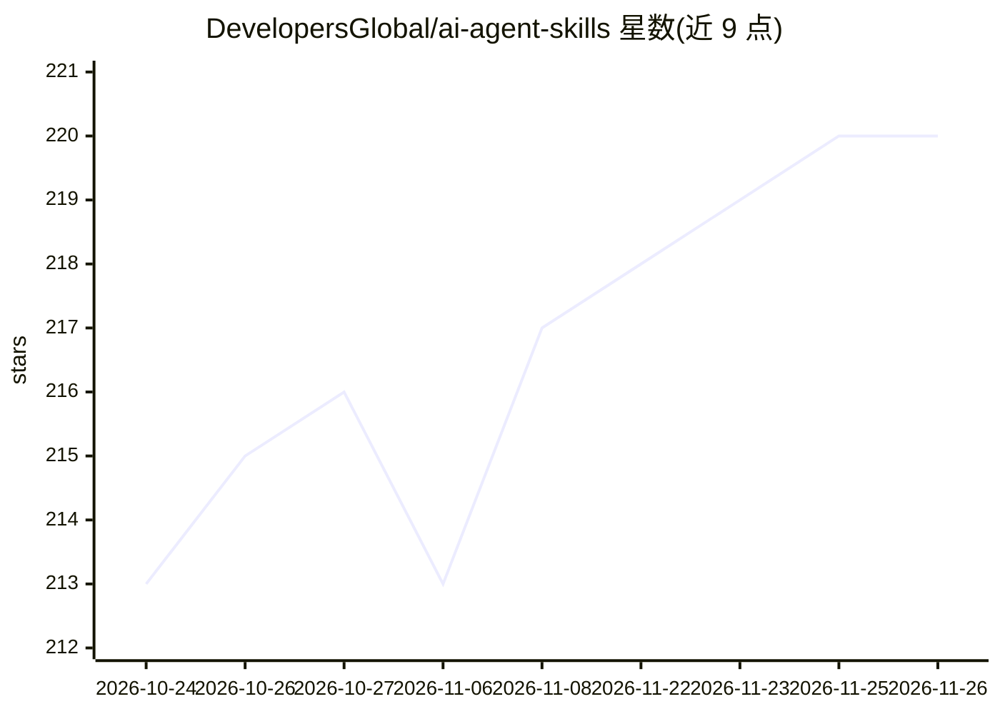

# DevelopersGlobal/ai-agent-skills

⭐ 220 · Python · MIT · 推送 2026-11-25 · [GitHub](https://github.com/DevelopersGlobal/ai-agent-skills) · [官网](https://developersglobal.github.io/ai-agent-skills/) · 组织维护

**面向开发者的 AI 编码 agent 技能文件库**

一个策划维护的 SKILL.md 结构化提示词集合，收录 30+ 条技能文件，按 Think/Plan/Build/Test/Review/Harden/Ship 七阶段及日常效率类别组织，内容涵盖任务分解、TDD、安全加固、RAG 与记忆、提示注入防御等工程工作流。使用方式为将技能内容复制进 agent 的系统提示或规则文件（CLAUDE.md、.cursor/rules、GEMINI.md），并提供 GitHub Pages 浏览器支持全文搜索、分类筛选与一键复制。MIT 许可，欢迎贡献。

## 筛选速览

| 维度 | 判定 | 备注 |
|---|---|---|
| AI 角色 | `ai-knowledge` | 知识聚合/清单类 |
| 许可风险 | `permissive` | MIT |
| 部署形态 | `None` |  |
| 模型依赖 | — | README 未给出锁定关系 |
| 硬件要求 | — | 无带数字的原话,不猜 |
| 安装摩擦 | `low` | 无编译、无系统依赖或容器化 |
| 成熟度 | — | 结构信号不足 |

## 能力要点

- 30+ 条 SKILL.md 技能文件，按七阶段工作流分类组织
- 技能编码带步骤、检查点与反模式防护的完整工作流
- GitHub Pages 浏览器提供全文搜索、筛选与一键复制
- 兼容 Claude/Cursor/Copilot/Gemini CLI 等多类 agent

## 适用场景

- 给 AI 编码 agent 添加生产级工作流约束与质量门
- 为团队沉淀可复用的提示词规范与安全防御技能
- 快速检索并复制所需的 agent 技能文件

## 场景标签

`提示工程` `精选清单` · 领域:Agent 开发

## 证据(README 行号)

> L17: AI agents are only as good as the instructions they follow. **AI Agent Skills** is a curated, battle-tested library
> L76: ## 📚 All Skills
> L165: The full skills library is browsable at **developersglobal.github.io/ai-agent-skills** with:

## 星数曲线

2026-10-24 213 → 2026-11-26 220（+7）

---
*卡片 v1 · prompt 1.4 · 生成 2026-11-25 · 置信度 high · 依据 README sha `ce1a54bae45e` · [字段定义](../../DATASET.md)*
