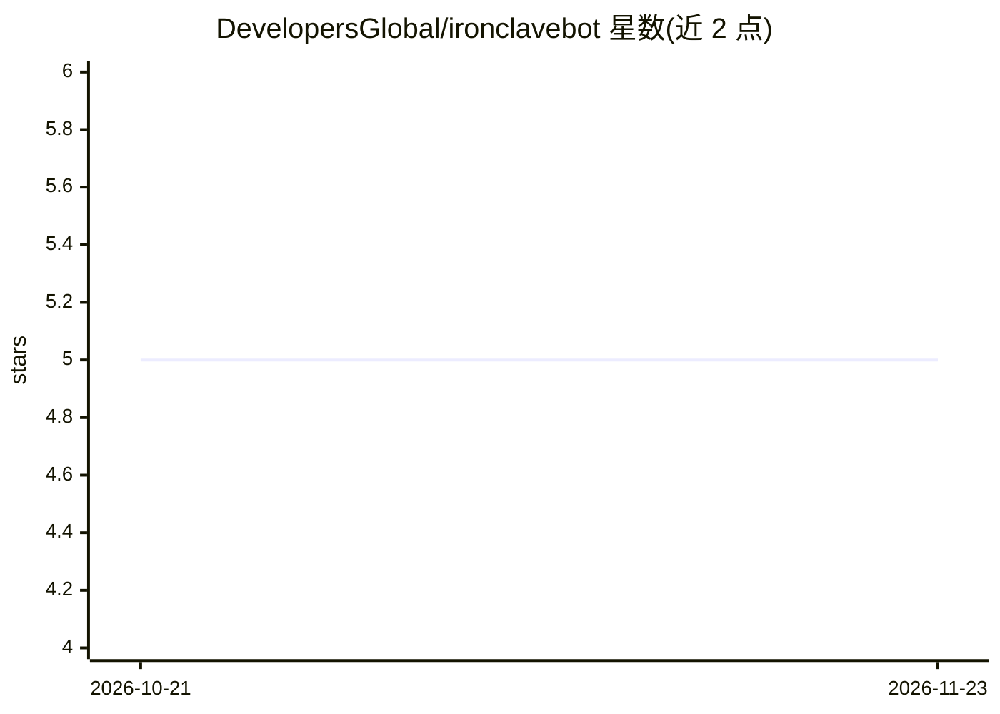

# DevelopersGlobal/ironclavebot

⭐ 5 · Go · Apache-2.0 · 推送 2026-10-19 · [GitHub](https://github.com/DevelopersGlobal/ironclavebot) · 组织维护

**给开发者的自托管沙箱 AI Agent，单二进制运行**

Go 编写的自托管 AI Agent 工作区：将 Agent 的终端与文件系统操作隔离在受限沙箱内，含目录边界校验、破坏性命令熔断；内嵌 Web 仪表盘与零配置本地记忆，编译为小于 10MB 的单个静态二进制。LLM 后端支持 OpenAI API key 或本地 Ollama，另提供 CLI 对话模式。默认 interactive/strict 安全模式拒绝命令执行与文件写入（尚无审批机制），permissive 模式建议仅在容器或 VM 内使用。

## 筛选速览

| 维度 | 判定 | 备注 |
|---|---|---|
| AI 角色 | `ai-ecosystem` | LLM/agent 周边工具 |
| 许可风险 | `permissive` | Apache-2.0 |
| 部署形态 | `self-host` | docker 或自建部署 |
| 模型依赖 | local-ok | 支持本地模型 |
| 硬件要求 | — | 无带数字的原话,不猜 |
| 安装摩擦 | `low` | 无编译、无系统依赖或容器化 |
| 成熟度 | — | 结构信号不足 |

## 能力要点

- 编译为单个静态二进制（<10MB），内嵌 Web 仪表盘
- 沙箱隔离：目录边界校验与破坏性命令熔断
- 支持本地 Ollama 或自带 API key，零云端遥测
- 三种运行方式：Go 构建、Docker、CLI 对话模式

## 适用场景

- 在沙箱容器内给本地小模型一个可操作的 Agent 终端
- 开发者在本地自托管运行带隔离约束的编码助手
- 用 CLI 模式让 Agent 检查并总结工作区代码

## 场景标签

`编码 Agent` `AI 助手` · 领域:编码与开发

## 证据(README 行号)

> L16: **IronClaveBot** is an open-source, self-hosted alternative to heavy computer-use bots and proprietary agent worksp
> L21: Giving an AI agent direct terminal and filesystem access is dangerous. IronClaveBot isolates all tool executions in
> L83: # LLM Provider: openai | ollama | mock

## 星数曲线

2026-10-21 5 → 2026-11-23 5（+0）

---
*卡片 v1 · prompt 1.4 · 生成 2026-11-21 · 置信度 high · 依据 README sha `e09c58e75cf2` · [字段定义](../../DATASET.md)*
