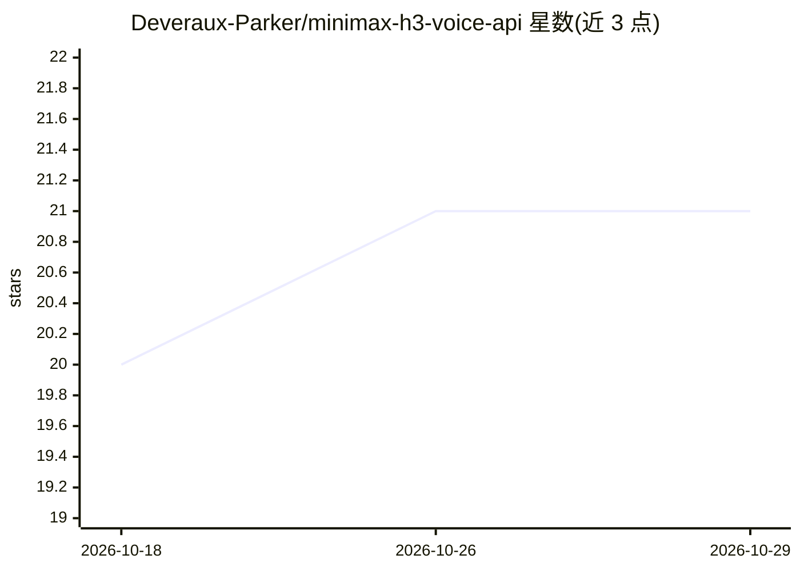

# Deveraux-Parker/minimax-h3-voice-api

⭐ 21 · Python · MIT · 推送 2026-08-09 · [GitHub](https://github.com/Deveraux-Parker/minimax-h3-voice-api) · 个人维护

**把 ComfyUI 里的 MiniMax H3 封装为 OpenAI/ElevenLabs 兼容语音 API**

本地 FastAPI 服务，读取已安装的 ComfyUI MiniMax H3 模型，暴露 OpenAI 兼容的 /v1/audio/speech 与 /v1/audio/transcriptions、ElevenLabs 兼容的 TTS 路由：长文本分块合成、PCM 流式、26 个人声与描述语音、音频/视频声音克隆、带段落标签的歌曲与 99 个音乐预设生成，另有 Vox Atelier 浏览器工作台与 ComfyUI H3 Music Studio 节点。转写核验用 onnx-asr 在 CPU 运行 Parakeet，不占 CUDA。限制：需 Linux、FFmpeg、NVIDIA GPU（开发于 24GB RTX 4090）、ComfyUI 及五个模型文件；服务无鉴权，不可暴露公网；仅分发应用代码不含模型权重。

## 筛选速览

| 维度 | 判定 | 备注 |
|---|---|---|
| AI 角色 | `ai-ecosystem` | LLM/agent 周边工具 |
| 许可风险 | `permissive` | MIT |
| 部署形态 | `library` | 以包/库形式分发 |
| 模型依赖 | — | README 未给出锁定关系 |
| 硬件要求 | `cpu-ok` | |
| 安装摩擦 | `medium` | 含编译或系统依赖之一 |
| 成熟度 | `idea` | |

## 能力要点

- OpenAI/ElevenLabs 兼容路由：语音合成、流式 PCM、CPU 转写
- 声音克隆（音频/视频，FFmpeg 抽取归一化）与全转录本校验自动重试
- 结构化歌曲生成（段落标签、99 音乐预设、5–60 秒）与 H3 Music Studio ComfyUI 节点
- H3 任务串行化以保护 24GB GPU 不被并行生成压垮

## 适用场景

- 用现有 OpenAI/ElevenLabs 客户端调用本地 MiniMax H3 做语音合成
- 长文本有声内容与带段落结构的歌曲本地生成
- 在 ComfyUI 工作流中直接使用 H3 音乐节点
- 本地批量转录音频/视频并输出 srt/vtt 字幕

## 场景标签

`语音合成` `语音识别` · 领域:内容生成

## 证据(README 行号)

> L3: A local FastAPI service that turns MiniMax H3 in ComfyUI into an OpenAI- and
> L14: - OpenAI-compatible `POST /v1/audio/speech`
> L42: - A working recent ComfyUI installation with MiniMax H3 nodes

## 星数曲线

2026-10-18 20 → 2026-10-29 21（+1）

---
*卡片 v1 · prompt 1.4 · 生成 2026-10-28 · 置信度 mid · 依据 README sha `5cc5b2d53e35` · [字段定义](../../DATASET.md)*
