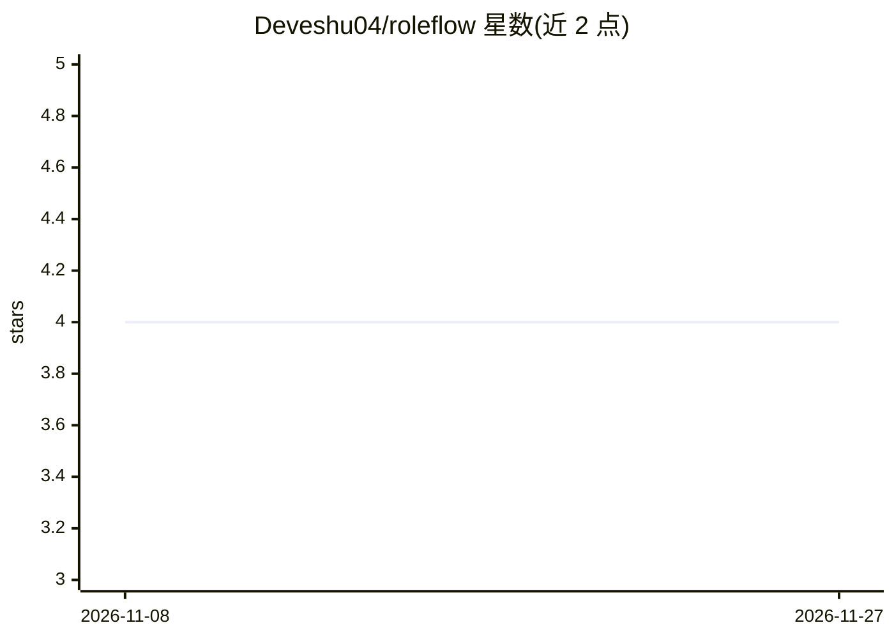

# Deveshu04/roleflow

⭐ — · [GitHub]() · 个人维护

**求职者的 AI 申请代理：搜索职位、定制简历、代填申请表**

开源 AI 求职申请代理，基于 Next.js 16 与 Playwright 构建。功能覆盖：从 LinkedIn 公开列表及 Greenhouse/Lever/Ashby 招聘站检索职位、解析上传的 PDF/DOCX 简历、给出带证据的匹配分析、按职位重写简历 PDF 与求职信，并由浏览器代理在真实申请表单中填写。代理在每个步骤接收页面交互元素编号映射与截图，返回工具调用由 Playwright 执行器执行。设有提交闸门、URL 白名单、token 上限等代码级护栏，提交前必须用户批准；本地运行，数据存于本机，简历与页面内容发送至 OpenAI 处理。

## 筛选速览

| 维度 | 判定 | 备注 |
|---|---|---|
| AI 角色 | `ai-native` | 本体是模型或模型工具 |
| 许可风险 | `permissive` | — |
| 部署形态 | `library` | 以包/库形式分发 |
| 模型依赖 | — | README 未给出锁定关系 |
| 硬件要求 | — | 无带数字的原话,不猜 |
| 安装摩擦 | `low` | 无编译、无系统依赖或容器化 |
| 成熟度 | — | 结构信号不足 |

## 能力要点

- 浏览器代理填写真实申请表：文本框、下拉、type-ahead、复选框与简历上传
- 按职位定制简历 PDF 与求职信，每处修改附理由并还原雇主/日期/教育信息
- Autopilot 模式批量搜索-匹配-定制-申请，仍逐个等待用户批准
- 代码级护栏：提交闸门、URL 白名单、重试与 token 上限

## 适用场景

- 批量申请职位时让代理代为填写表单，自己只做最终审批
- 针对每个职位生成定制简历并查看修改理由
- 上传简历获得匹配分数、证据与待确认事项清单

## 场景标签

`浏览器自动化` `AI 写作` · 领域:效率与自动化

## 证据(README 行号)

> L5: **An open-source AI agent that finds real jobs, tailors your resume to each one, and fills in the actual application
> L40: |🤖 **Browser agent**|Opens the real application in Chrome and fills it in: text fields, dropdowns, type-aheads, che
> L95: |`OPENAI_API_KEY`|—|**Required.** Used for parsing, matching, tailoring, web search and the agent.|

## 星数曲线

2026-11-08 4 → 2026-11-27 4（+0）

---
*卡片 v1 · prompt 1.4 · 生成 2026-11-21 · 置信度 high · 依据 README sha `1c4d7f2873dc` · [字段定义](../../DATASET.md)*
