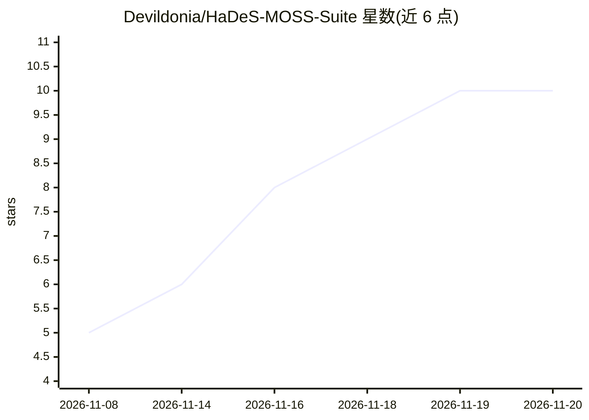

# Devildonia/HaDeS-MOSS-Suite

⭐ 10 · Python · MIT · 推送 2026-11-19 · [GitHub](https://github.com/Devildonia/HaDeS-MOSS-Suite) · 个人维护

**ComfyUI 的 MOSS-Image 模型节点套件：加载、合并与 LoRA 管理**

面向 ComfyUI 的 MOSS-Image 模型族自定义节点集，以 HaDeS Anima Suite 风格提供。节点覆盖：单节点加载模型/文本编码器/VAE 的 MOSS Loader、按层组合并两个或 2–4 个模型的 Block/Multi-Model Merger（支持 TIES/DARE/SLERP 等方法）、LoRA 提取（截断 SVD）、按层组分权重加载与堆叠 LoRA、布局编辑器、Prompt Enhancer、图像对比与审计工具等。声称各层组作用的结论由 tools/moss_eval.py 实测而非假定。通过 git clone 到 custom_nodes 安装，无额外依赖。

## 筛选速览

| 维度 | 判定 | 备注 |
|---|---|---|
| AI 角色 | `ai-native` | 本体是模型或模型工具 |
| 许可风险 | `permissive` | MIT |
| 部署形态 | `None` |  |
| 模型依赖 | — | README 未给出锁定关系 |
| 硬件要求 | — | 无带数字的原话,不猜 |
| 安装摩擦 | `medium` | 含编译或系统依赖之一 |
| 成熟度 | — | 结构信号不足 |

## 能力要点

- MOSS Loader 单节点加载模型、Qwen3.5-9B 文本编码器与 FLUX.2 VAE
- 模型合并支持 TIES/DARE/Task Arithmetic/Model Stock/SLERP，逐层组设置比例
- LoRA 提取器用截断 SVD 将模型差值存为 LoRA，输出能量保留率
- 自带实测评估工具 tools/moss_eval.py 与结果文档

## 适用场景

- 在 ComfyUI 中一站式加载 MOSS-Image 权重并采样生成
- 对社区 MOSS 微调模型做逐层组合并或提取 LoRA
- 用少步 Turbo LoRA 按 CFG 1 设置出图
- 对比多个模型/LoRA 在同一节点内采样并生成对比图

## 场景标签

`图像生成` `微调` · 领域:内容生成

## 证据(README 行号)

> L3: ComfyUI nodes for the **MOSS-Image** model family (OpenMOSS / Comfy Org: 42-layer single-stream DiT, `Qwen3.5-9B` te
> L11: **By version** (details in `CHANGELOG.md`): **0.2.0 / 0.3.0:** the turbo LoRAs and the KSampler's `turbo` input. **

## 星数曲线

2026-11-08 5 → 2026-11-20 10（+5）

---
*卡片 v1 · prompt 1.4 · 生成 2026-11-20 · 置信度 mid · 依据 README sha `05e2296cfacb` · [字段定义](../../DATASET.md)*
