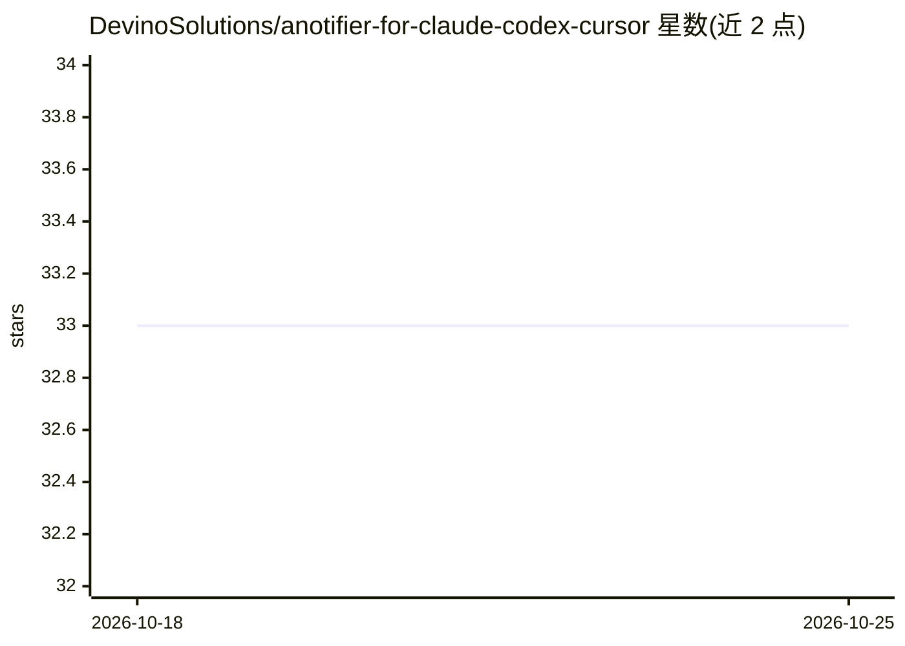

# DevinoSolutions/anotifier-for-claude-codex-cursor

⭐ 33 · JavaScript · AGPL-3.0 · 推送 2026-10-22 · [GitHub](https://github.com/DevinoSolutions/anotifier-for-claude-codex-cursor) · [官网](https://anotifier.io) · 组织维护

**为 AI 编程 agent 提供桌面/手机通知的工具**

通过各 AI 编程工具（Claude Code、Codex CLI、Cursor、Gemini CLI、Antigravity CLI）的原生 hook 机制，在任务完成或需要输入时发送通知：桌面 toast（Windows/macOS/Linux/WSL）、ntfy 手机推送、Slack/Discord/Telegram webhook 与终端响铃，统一由 ~/.anotifier/config.json 配置。安装向导自动检测已装工具并接线，支持 npx/npm、Claude Code 插件市场和独立脚本三种安装方式。纯 Node.js 内置模块实现，无生产依赖。

## 筛选速览

| 维度 | 判定 | 备注 |
|---|---|---|
| AI 角色 | `ai-ecosystem` | LLM/agent 周边工具 |
| 许可风险 | `viral` | AGPL-3.0 |
| 部署形态 | `desktop` | 安装包/桌面程序 |
| 模型依赖 | — | README 未给出锁定关系 |
| 硬件要求 | — | 无带数字的原话,不猜 |
| 安装摩擦 | `low` | 无编译、无系统依赖或容器化 |
| 成熟度 | — | 结构信号不足 |

## 能力要点

- 覆盖 Claude Code/Codex/Cursor/Gemini CLI/Antigravity CLI 五种工具的 hook 集成
- 桌面 toast、ntfy 手机推送、webhook（Slack/Discord/Telegram/generic）、终端响铃多通道
- 安装向导自动检测工具并接线，统一 config.json 配置
- 零 npm 生产依赖，纯 Node.js 内置模块

## 适用场景

- 跑长任务时用手机接收 agent 完成或等待输入的推送
- 在 Slack/Discord/Telegram 中接收编码 agent 的状态通知
- 免打断地在桌面端获知 Claude Code/Codex 任务结束并点击回到对应窗口

## 场景标签

 · 领域:开发者工具/AI 编程 agent 配套

## 证据(README 行号)

> L3:  Desktop & phone notifications for AI coding agents
> L34:  Desktop toasts on the laptop and ntfy push notifications on the phone — Claude Code task complete, Codex needs inp
> L74:  &nbsp; Claude Code

## 星数曲线

2026-10-18 33 → 2026-10-25 33（+0）

---
*卡片 v1 · prompt 1.4 · 生成 2026-10-25 · 置信度 high · 依据 README sha `111c3c866d80` · [字段定义](../../DATASET.md)*
