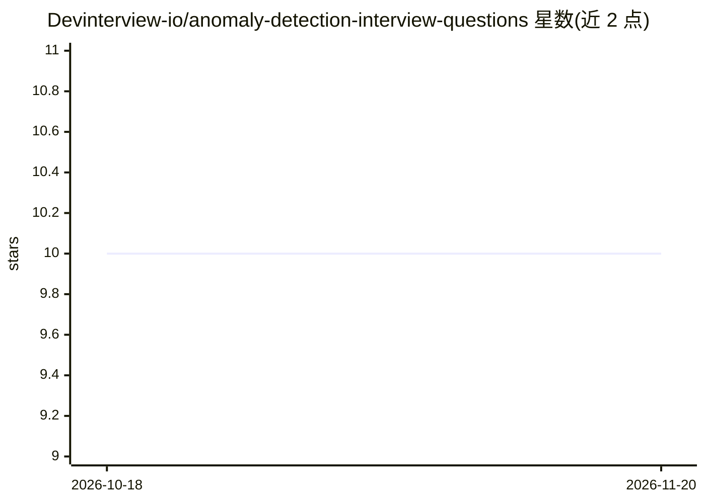

# Devinterview-io/anomaly-detection-interview-questions

⭐ 10 · 推送 2026-01-04 · [GitHub](https://github.com/Devinterview-io/anomaly-detection-interview-questions) · 组织维护

**机器学习求职者备考异常检测面试题库**

收录 50 道异常检测面试题及解答的备考资料，覆盖定义、异常类型（上下文/集体/点异常）、监督与无监督方法、评价指标（ROC-AUC、F1 等）、离群点对建模的影响及预处理手段等内容。面向准备机器学习与数据科学岗位面试的求职者，以问答形式组织，完整答案托管在外部站点 Devinterview.io。

## 筛选速览

| 维度 | 判定 | 备注 |
|---|---|---|
| AI 角色 | `ai-knowledge` | 知识聚合/清单类 |
| 许可风险 | `none` | — |
| 部署形态 | `None` |  |
| 模型依赖 | — | README 未给出锁定关系 |
| 硬件要求 | — | 无带数字的原话,不猜 |
| 安装摩擦 | `low` | 无编译、无系统依赖或容器化 |
| 成熟度 | — | 结构信号不足 |

## 能力要点

- 50 道异常检测面试问答，按主题编号组织
- 覆盖监督/无监督/半监督方法及常用算法（Isolation Forest、LOF、One-Class SVM）
- 列出欺诈检测、网络安全、预测性维护等应用场景
- 完整答案集合托管于 Devinterview.io 网站

## 适用场景

- 准备机器学习/数据科学岗位的异常检测面试
- 复习异常检测的核心概念与评价指标
- 了解离群点处理与数据预处理常用技术

## 场景标签

`教程课程` · 领域:学习与行业

## 证据(README 行号)

> L1: # 50 Essential Anomaly Detection Interview Questions in 2026
> L7: #### You can also find all 50 answers here 👉 Devinterview.io - Anomaly Detection
> L9: ## 1. What is _anomaly detection_?

## 星数曲线

2026-10-18 10 → 2026-11-20 10（+0）

---
*卡片 v1 · prompt 1.4 · 生成 2026-11-20 · 置信度 high · 依据 README sha `136ec6584905` · [字段定义](../../DATASET.md)*
