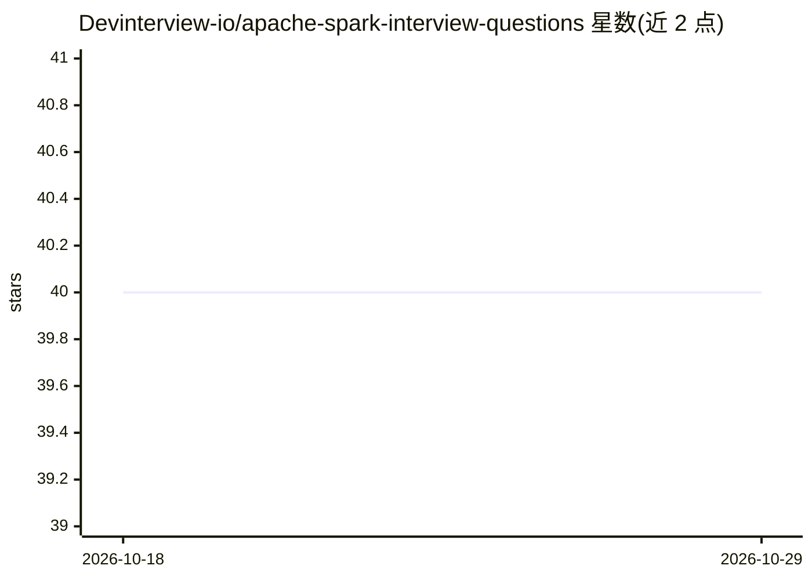

# Devinterview-io/apache-spark-interview-questions

⭐ 40 · 推送 2026-01-04 · [GitHub](https://github.com/Devinterview-io/apache-spark-interview-questions) · 组织维护

**Apache Spark 面试题与答案集合（55 题），面向 2026 年面试备考**

由 Devinterview.io 维护的 Apache Spark 面试知识库，收录 55 道常见面试问题及答案，覆盖 Spark 架构组件（RDD/DataFrame/Streaming/MLlib）、与 Hadoop MapReduce 的对比、惰性求值、容错机制等主题。内容以 Markdown 问答形式组织并附带 PySpark 代码示例，完整答案需前往 Devinterview.io 网站查看。仓库本体为静态内容，无安装或运行步骤，适合机器学习与数据科学求职者系统复习 Spark 知识点。

## 筛选速览

| 维度 | 判定 | 备注 |
|---|---|---|
| AI 角色 | `ai-knowledge` | 知识聚合/清单类 |
| 许可风险 | `none` | — |
| 部署形态 | `None` |  |
| 模型依赖 | — | README 未给出锁定关系 |
| 硬件要求 | — | 无带数字的原话,不猜 |
| 安装摩擦 | `low` | 无编译、无系统依赖或容器化 |
| 成熟度 | — | 结构信号不足 |

## 能力要点

- 55 道 Apache Spark 面试问题及答案
- 覆盖 RDD/DataFrame/Streaming/MLlib 等核心组件
- 附 PySpark 代码示例（Spark SQL、惰性求值等）
- 与 Hadoop MapReduce 的多维度对比

## 适用场景

- 准备数据科学/机器学习岗位的 Spark 面试
- 系统复习 Spark 核心概念（RDD、惰性求值、容错）
- 对比学习 Spark 与 Hadoop MapReduce 的差异

## 场景标签

`教程课程` · 领域:学习与行业

## 证据(README 行号)

> L1: # 55 Common Apache Spark Interview Questions in 2026
> L7: #### You can also find all 55 answers here 👉 Devinterview.io - Apache Spark

## 星数曲线

2026-10-18 40 → 2026-10-29 40（+0）

---
*卡片 v1 · prompt 1.4 · 生成 2026-10-25 · 置信度 high · 依据 README sha `1d8a0f8a9b6a` · [字段定义](../../DATASET.md)*
