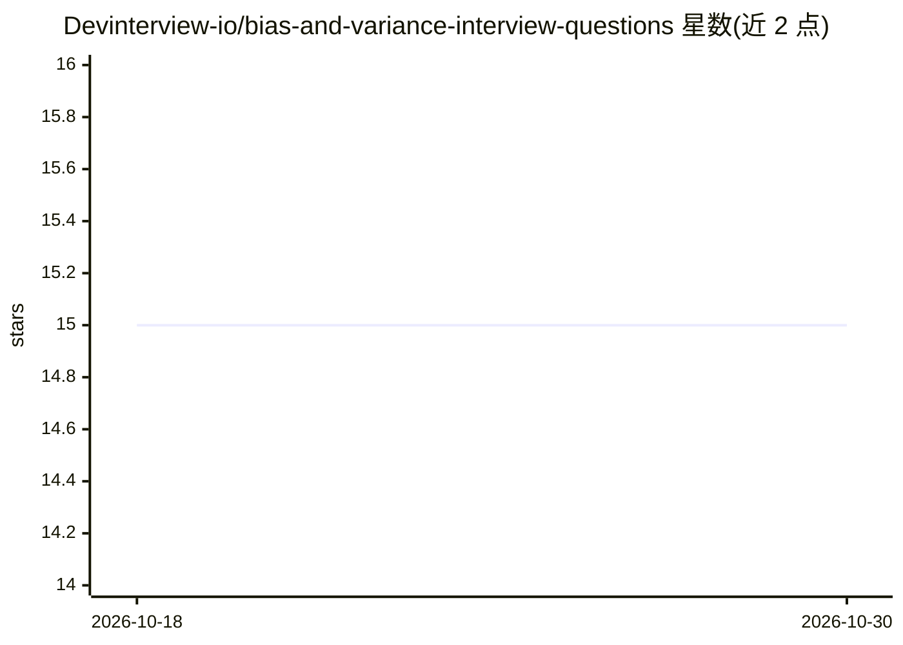

# Devinterview-io/bias-and-variance-interview-questions

⭐ 15 · 推送 2026-01-04 · [GitHub](https://github.com/Devinterview-io/bias-and-variance-interview-questions) · 组织维护

**偏置与方差面试题库：45 道机器学习面试问答**

Devinterview.io 维护的机器学习面试知识仓库，围绕偏置（bias）与方差（variance）主题收录 45 道问答，覆盖定义、误差分解公式、偏置-方差权衡、模型复杂度关系与高方差的成因等。每题附 Markdown 排版的答案，部分题目附 Python 代码示例（使用 numpy/matplotlib/sklearn）与数学推导。完整答案在 Devinterview.io 网站上，仓库本身为纯文档，无可安装或运行的程序。

## 筛选速览

| 维度 | 判定 | 备注 |
|---|---|---|
| AI 角色 | `ai-knowledge` | 知识聚合/清单类 |
| 许可风险 | `none` | — |
| 部署形态 | `None` |  |
| 模型依赖 | — | README 未给出锁定关系 |
| 硬件要求 | — | 无带数字的原话,不猜 |
| 安装摩擦 | `low` | 无编译、无系统依赖或容器化 |
| 成熟度 | — | 结构信号不足 |

## 能力要点

- 45 道偏置与方差主题的面试问答
- 含误差分解数学推导（MSE = bias² + variance + 不可约误差）
- 部分题目附 numpy/matplotlib/sklearn Python 代码示例

## 适用场景

- 机器学习/数据科学面试前复习偏置与方差概念
- 学习偏置-方差权衡与模型复杂度的关系
- 查找带代码示例的面试题参考答案

## 场景标签

`教程课程` · 领域:学习与行业

## 证据(README 行号)

> L1: # 45 Core Bias And Variance Interview Questions in 2026
> L7: #### You can also find all 45 answers here 👉 Devinterview.io - Bias And Variance

## 星数曲线

2026-10-18 15 → 2026-10-30 15（+0）

---
*卡片 v1 · prompt 1.4 · 生成 2026-10-30 · 置信度 high · 依据 README sha `f7ea05e5d808` · [字段定义](../../DATASET.md)*
