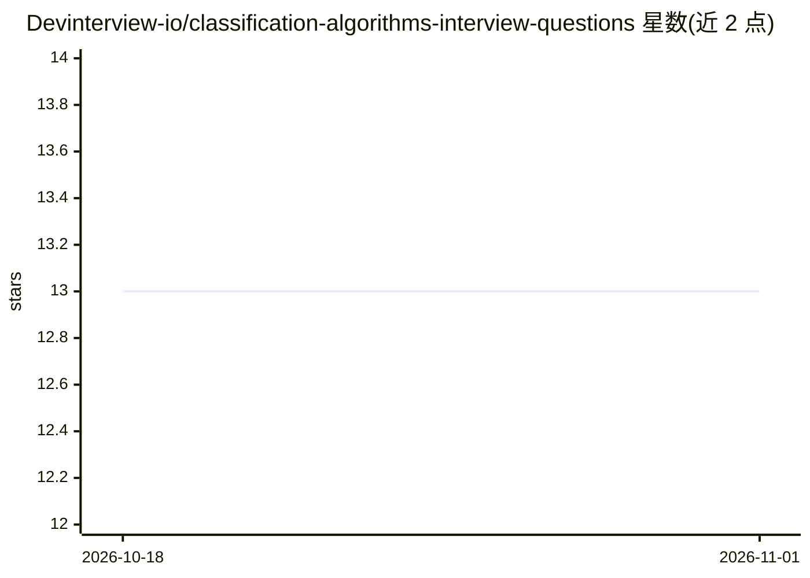

# Devinterview-io/classification-algorithms-interview-questions

⭐ 13 · 推送 2026-01-04 · [GitHub](https://github.com/Devinterview-io/classification-algorithms-interview-questions) · 组织维护

**机器学习分类算法面试题清单（52题，2026）**

Devinterview-io 维护的分类算法面试问答集：以 52 个问题的形式覆盖机器学习分类主题，包括二分类与多分类、损失函数（Logistic/交叉熵/Hinge/Gini）、生成式与判别式模型、决策边界等概念，部分问题附公式与对比表。答案完整版托管于 Devinterview.io 网站，仓库内为题目与部分内容的 Markdown 文本，无安装或运行环节，面向求职备考的数据科学与机器学习学习者。

## 筛选速览

| 维度 | 判定 | 备注 |
|---|---|---|
| AI 角色 | `ai-knowledge` | 知识聚合/清单类 |
| 许可风险 | `none` | — |
| 部署形态 | `None` |  |
| 模型依赖 | — | README 未给出锁定关系 |
| 硬件要求 | — | 无带数字的原话,不猜 |
| 安装摩擦 | `low` | 无编译、无系统依赖或容器化 |
| 成熟度 | — | 结构信号不足 |

## 能力要点

- 52 个分类算法面试问题，2026 年版
- 覆盖损失函数、生成/判别模型、决策边界等主题，附数学公式
- 完整答案链接至 Devinterview.io

## 适用场景

- 准备数据科学/机器学习面试的分类算法部分
- 按问题索引复习分类算法核心概念

## 场景标签

`教程课程` · 领域:学习与行业

## 证据(README 行号)

> L1: # 52 Fundamental Classification Algorithms Interview Questions in 2026
> L7: #### You can also find all 52 answers here 👉 Devinterview.io - Classification Algorithms

## 星数曲线

2026-10-18 13 → 2026-11-01 13（+0）

---
*卡片 v1 · prompt 1.4 · 生成 2026-10-31 · 置信度 high · 依据 README sha `a67efcee0cfb` · [字段定义](../../DATASET.md)*
