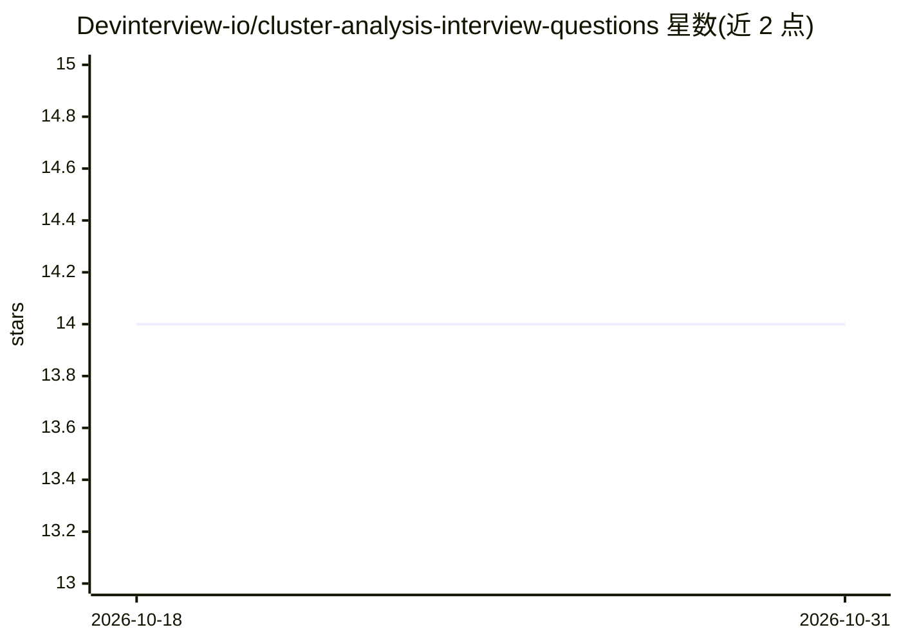

# Devinterview-io/cluster-analysis-interview-questions

⭐ 14 · 推送 2026-01-04 · [GitHub](https://github.com/Devinterview-io/cluster-analysis-interview-questions) · 组织维护

**面向数据科学求职者的聚类分析面试题集（50 题）**

Devinterview.io 维护的机器学习面试准备知识库中的一个专题：收录 50 道聚类分析面试问题及解答，覆盖基本概念（监督/无监督学习区别）、相似度度量、质心与距离矩阵等关键概念，列举客户细分、异常检测、图像分割、基因数据分析等 16 类应用场景，并讨论高维数据聚类的挑战（维度灾难、欧氏距离退化、计算开销等）。完整答案托管在 Devinterview.io 网站，仓库内为问题与部分要点。供准备 2026 年机器学习/数据科学面试的求职者复习使用。

## 筛选速览

| 维度 | 判定 | 备注 |
|---|---|---|
| AI 角色 | `ai-knowledge` | 知识聚合/清单类 |
| 许可风险 | `none` | — |
| 部署形态 | `None` |  |
| 模型依赖 | — | README 未给出锁定关系 |
| 硬件要求 | — | 无带数字的原话,不猜 |
| 安装摩擦 | `low` | 无编译、无系统依赖或容器化 |
| 成熟度 | — | 结构信号不足 |

## 能力要点

- 50 道聚类分析面试问题，附关键概念与应用场景
- 覆盖监督 vs 无监督学习、相似度度量、质心、距离矩阵等概念
- 列举 16 类聚类应用场景（客户细分、异常检测、图像分割等）
- 讨论高维数据聚类的 7 项挑战

## 适用场景

- 准备数据科学/机器学习岗位的技术面试
- 复习聚类分析核心概念与常见考点
- 了解聚类在各行业中的应用方式

## 场景标签

`教程课程` · 领域:学习与行业

## 证据(README 行号)

> L1: # 50 Must-Know Cluster Analysis Interview Questions in 2026
> L7: #### You can also find all 50 answers here 👉 Devinterview.io - Cluster Analysis

## 星数曲线

2026-10-18 14 → 2026-10-31 14（+0）

---
*卡片 v1 · prompt 1.4 · 生成 2026-10-31 · 置信度 high · 依据 README sha `96efe3fb4d16` · [字段定义](../../DATASET.md)*
