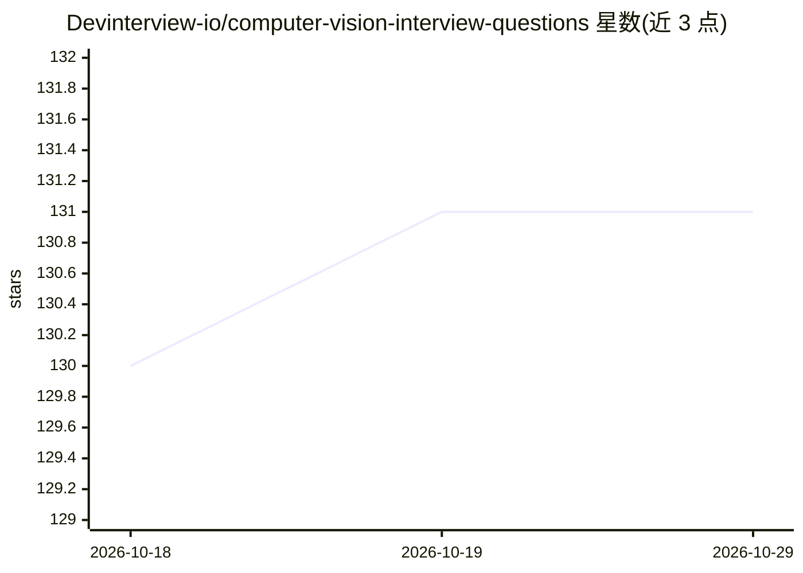

# Devinterview-io/computer-vision-interview-questions

⭐ 131 · 推送 2026-01-04 · [GitHub](https://github.com/Devinterview-io/computer-vision-interview-questions) · 组织维护

**面向求职者的 54 道计算机视觉面试问答集（2026）**

Devinterview.io 维护的计算机视觉面试题合集，收录 54 道基础问题并附答案入口（完整答案在 Devinterview.io 站点）。内容为知识讲解型文档：涵盖计算机视觉与人眼视觉对比、CV 系统组成、图像分割技术与评估指标、图像处理与 CV 的区别、Sobel/Canny 边缘检测算法原理、CNN 层级结构等，部分题目附 Python/OpenCV 代码示例。以 Markdown 仓库形式提供，无安装或运行步骤。

## 筛选速览

| 维度 | 判定 | 备注 |
|---|---|---|
| AI 角色 | `ai-knowledge` | 知识聚合/清单类 |
| 许可风险 | `none` | — |
| 部署形态 | `None` |  |
| 模型依赖 | — | README 未给出锁定关系 |
| 硬件要求 | — | 无带数字的原话,不猜 |
| 安装摩擦 | `low` | 无编译、无系统依赖或容器化 |
| 成熟度 | — | 结构信号不足 |

## 能力要点

- 54 道计算机视觉面试题，按主题组织
- 覆盖分割、边缘检测、CNN 等基础概念与算法原理
- 附 Python/OpenCV 代码示例（K-means 分割、Canny、Sobel）
- 完整答案链接至 Devinterview.io 站点

## 适用场景

- 准备机器学习/数据科学岗位的计算机视觉面试
- 系统复习 CV 基础概念与常见考点
- 查面试题参考答案进行对照自查

## 场景标签

`教程课程` · 领域:学习与行业

## 证据(README 行号)

> L1: # 54 Fundamental Computer Vision Interview Questions in 2026
> L7: #### You can also find all 54 answers here 👉 Devinterview.io - Computer Vision
> L9: ## 1. What is _computer vision_ and how does it relate to human vision?

## 星数曲线

2026-10-18 130 → 2026-10-29 131（+1）

---
*卡片 v1 · prompt 1.4 · 生成 2026-10-22 · 置信度 high · 依据 README sha `7e89a22330f7` · [字段定义](../../DATASET.md)*
