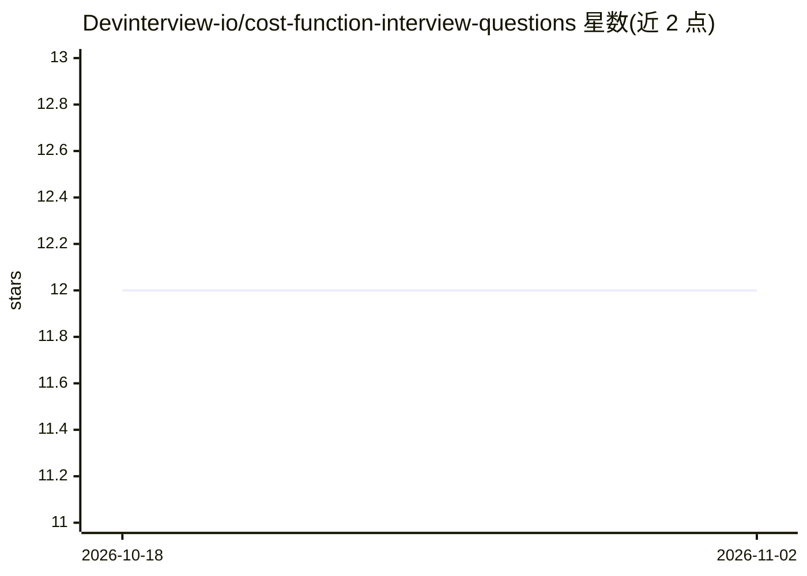

# Devinterview-io/cost-function-interview-questions

⭐ 12 · 推送 2026-01-04 · [GitHub](https://github.com/Devinterview-io/cost-function-interview-questions) · 组织维护

**机器学习代价函数面试题集合（43 题，2026）**

Devinterview.io 维护的代价函数主题面试问答集，收录 43 道机器学习与数据科学面试题及答案，覆盖代价函数与损失函数的区别、常见代价函数（MSE、交叉熵、Hinge、Huber）、凸性与非凸性、全局最小值等内容。每题以概念说明、公式、可视化说明与 Python 代码示例组织，面向准备机器学习和数据科学面试的求职者，完整答案发布在 Devinterview.io 网站。

## 筛选速览

| 维度 | 判定 | 备注 |
|---|---|---|
| AI 角色 | `ai-knowledge` | 知识聚合/清单类 |
| 许可风险 | `none` | — |
| 部署形态 | `None` |  |
| 模型依赖 | — | README 未给出锁定关系 |
| 硬件要求 | — | 无带数字的原话,不猜 |
| 安装摩擦 | `low` | 无编译、无系统依赖或容器化 |
| 成熟度 | — | 结构信号不足 |

## 能力要点

- 43 道代价函数主题面试题及答案
- 覆盖 MSE/交叉熵/Hinge/Huber 等常见代价函数
- 每题附公式、概念讲解与 Python 代码示例
- 内容面向 2026 年面试准备并持续更新

## 适用场景

- 准备机器学习或数据科学岗位的技术面试
- 复习代价函数、凸优化等基础概念
- 获取带公式与代码示例的参考答案

## 场景标签

`教程课程` · 领域:学习与行业

## 证据(README 行号)

> L1: # 43 Essential Cost Function Interview Questions in 2026
> L7: #### You can also find all 43 answers here 👉 Devinterview.io - Cost Function

## 星数曲线

2026-10-18 12 → 2026-11-02 12（+0）

---
*卡片 v1 · prompt 1.4 · 生成 2026-11-01 · 置信度 high · 依据 README sha `d66acbcb45ed` · [字段定义](../../DATASET.md)*
