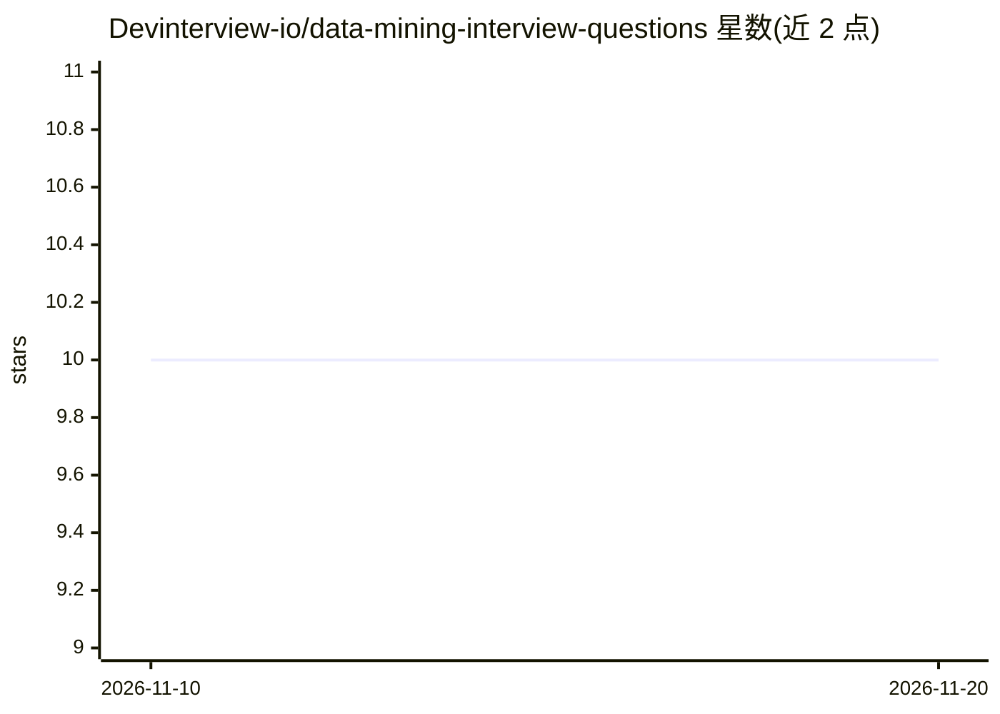

# Devinterview-io/data-mining-interview-questions

⭐ 10 · 推送 2026-01-04 · [GitHub](https://github.com/Devinterview-io/data-mining-interview-questions) · 组织维护

**数据挖掘面试题库：60 题带答案助准备 ML/数据科学面试**

Devinterview.io 出品的数据挖掘面试题集，收录 60 道常见面试题并提供答案。内容覆盖数据挖掘定义、KDD 流程、CRISP-DM 过程、聚类/分类/回归/关联规则等常见任务及其算法（K-means、DBSCAN、决策树等），附 Python 代码示例（如 sklearn 的 KMeans）。以文本教程形式呈现，所有题目也可在 Devinterview.io 网站查看，服务对象是准备机器学习与数据科学岗位面试的求职者。

## 筛选速览

| 维度 | 判定 | 备注 |
|---|---|---|
| AI 角色 | `ai-knowledge` | 知识聚合/清单类 |
| 许可风险 | `none` | — |
| 部署形态 | `None` |  |
| 模型依赖 | — | README 未给出锁定关系 |
| 硬件要求 | — | 无带数字的原话,不猜 |
| 安装摩擦 | `low` | 无编译、无系统依赖或容器化 |
| 成熟度 | — | 结构信号不足 |

## 能力要点

- 60 道数据挖掘常见面试题及答案
- 覆盖 KDD 与 CRISP-DM 流程等知识体系
- 附 K-means 聚类等 Python 代码示例
- 答案亦可在线上 Devinterview.io 站点查看

## 适用场景

- 准备数据科学/ML 岗位的技术面试
- 复习数据挖掘核心概念与算法
- 快速了解 KDD、CRISP-DM 等流程框架

## 场景标签

`教程课程` · 领域:学习与行业

## 证据(README 行号)

> L1: # 60 Common Data Mining Interview Questions in 2026
> L7: #### You can also find all 60 answers here 👉 Devinterview.io - Data Mining
> L9: ## 1. Define _data mining_ and explain its importance in the modern data-driven world.

## 星数曲线

2026-11-10 10 → 2026-11-20 10（+0）

---
*卡片 v1 · prompt 1.4 · 生成 2026-11-20 · 置信度 high · 依据 README sha `bba257ca5bb3` · [字段定义](../../DATASET.md)*
