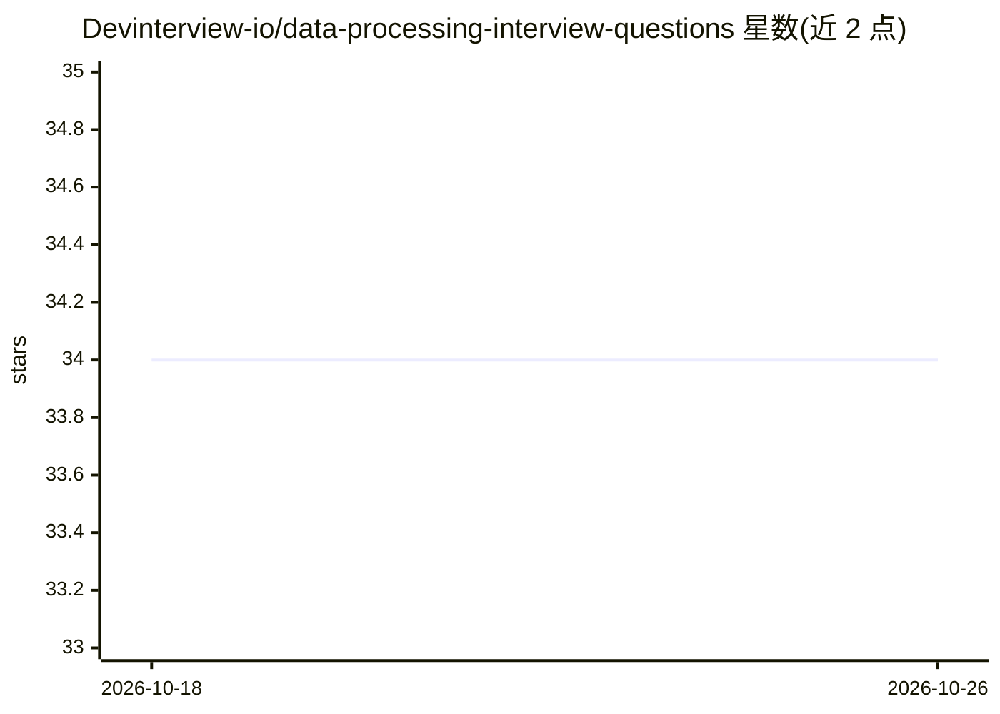

# Devinterview-io/data-processing-interview-questions

⭐ 34 · 推送 2026-01-04 · [GitHub](https://github.com/Devinterview-io/data-processing-interview-questions) · 组织维护

**数据预处理面试题与答案集：面向机器学习/数据科学求职者**

Devinterview.io 维护的面试题知识库，收录 100 道数据处理（data processing）面试问答，主题覆盖数据预处理、数据清洗、数据质量问题、结构化与非结构化数据、特征缩放、归一化与数据增强等，答案附 Python 代码示例（pandas、sklearn）与数学公式。完整答案发布于 Devinterview.io 网站，仓库以 Markdown 阅读材料形式提供，无安装或运行步骤。

## 筛选速览

| 维度 | 判定 | 备注 |
|---|---|---|
| AI 角色 | `ai-knowledge` | 知识聚合/清单类 |
| 许可风险 | `none` | — |
| 部署形态 | `None` |  |
| 模型依赖 | — | README 未给出锁定关系 |
| 硬件要求 | — | 无带数字的原话,不猜 |
| 安装摩擦 | `low` | 无编译、无系统依赖或容器化 |
| 成熟度 | — | 结构信号不足 |

## 能力要点

- 100 道数据处理面试问答题
- 主题覆盖预处理、清洗、特征缩放、归一化、数据增强
- 答案附 Python 代码示例（pandas/sklearn）与数学公式
- 完整答案链接至 Devinterview.io 网站

## 适用场景

- 准备机器学习或数据科学岗位的技术面试
- 系统复习数据处理与预处理概念
- 学习常见数据清洗与特征缩放技术的代码实现

## 场景标签

`教程课程` · 领域:学习与行业

## 证据(README 行号)

> L1: # 100 Important Data Processing Interview Questions in 2026
> L7: #### You can also find all 100 answers here 👉 Devinterview.io - Data Processing
> L9: ## 1. What is _data preprocessing_ in the context of _machine learning_?

## 星数曲线

2026-10-18 34 → 2026-10-26 34（+0）

---
*卡片 v1 · prompt 1.4 · 生成 2026-10-25 · 置信度 high · 依据 README sha `6658979b0c2d` · [字段定义](../../DATASET.md)*
