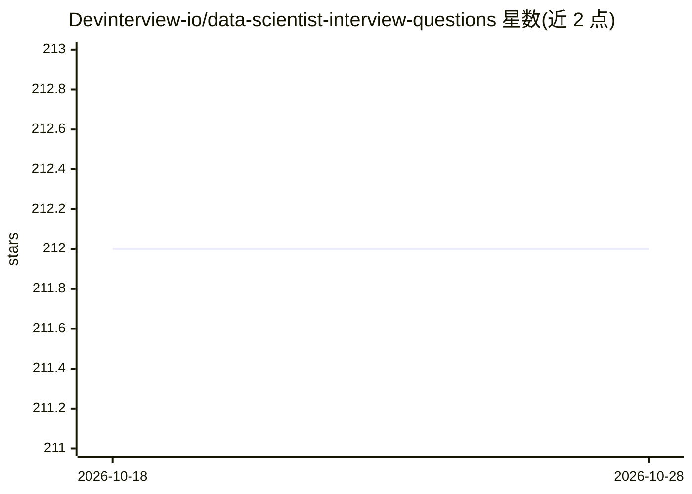

# Devinterview-io/data-scientist-interview-questions

⭐ 212 · 推送 2026-01-04 · [GitHub](https://github.com/Devinterview-io/data-scientist-interview-questions) · 组织维护

**数据科学家面试题与答案清单（100 题，2026 版）**

由 Devinterview.io 维护的机器学习与数据科学面试问答集合，覆盖机器学习基础概念、监督/无监督学习、分类与回归、过拟合与欠拟合、偏差-方差权衡、交叉验证、正则化（L1/L2/Elastic Net）等主题。每题附概念解释、要点对比与 Python/scikit-learn 代码示例，完整答案指向 Devinterview.io 站点。以 Markdown 文档形式提供，面向准备数据科学家与机器学习岗位面试的求职者。

## 筛选速览

| 维度 | 判定 | 备注 |
|---|---|---|
| AI 角色 | `ai-knowledge` | 知识聚合/清单类 |
| 许可风险 | `none` | — |
| 部署形态 | `None` |  |
| 模型依赖 | — | README 未给出锁定关系 |
| 硬件要求 | — | 无带数字的原话,不猜 |
| 安装摩擦 | `low` | 无编译、无系统依赖或容器化 |
| 成熟度 | — | 结构信号不足 |

## 能力要点

- 100 道数据科学/机器学习面试题及解答
- 每题附 Python/scikit-learn 代码示例
- 覆盖过拟合、偏差-方差、交叉验证、正则化等核心概念

## 适用场景

- 准备数据科学家或机器学习岗位的面试
- 系统复习机器学习基础概念并配合代码练习
- 查看完整答案可跳转 Devinterview.io 站点

## 场景标签

`教程课程` · 领域:学习与行业

## 证据(README 行号)

> L1: # 100 Must-Know Data Scientist Interview Questions in 2026
> L7: #### You can also find all 100 answers here 👉 Devinterview.io - Data Scientist

## 星数曲线

2026-10-18 212 → 2026-10-28 212（+0）

---
*卡片 v1 · prompt 1.4 · 生成 2026-10-22 · 置信度 high · 依据 README sha `de312813ad19` · [字段定义](../../DATASET.md)*
