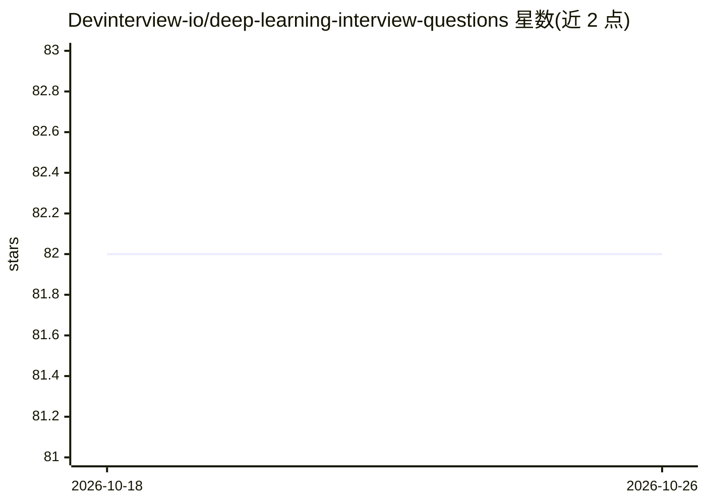

# Devinterview-io/deep-learning-interview-questions

⭐ 82 · 推送 2026-01-04 · [GitHub](https://github.com/Devinterview-io/deep-learning-interview-questions) · 组织维护

**面向求职者的深度学习面试题与答案合集（80 题）**

Devinterview.io 维护的深度学习面试准备资料仓库，收录 80 道面试问答题并附答案，题目覆盖深度学习定义、人工神经网络结构、网络深度原理、激活函数等基础主题，部分答案含数学推导与理论框架（VC 维、信息瓶颈等）讨论。内容以 Markdown 文档形式在 GitHub 发布，完整答案指向 Devinterview.io 网站，面向准备机器学习与数据科学面试的求职者，无需安装即可阅读。

## 筛选速览

| 维度 | 判定 | 备注 |
|---|---|---|
| AI 角色 | `ai-knowledge` | 知识聚合/清单类 |
| 许可风险 | `none` | — |
| 部署形态 | `None` |  |
| 模型依赖 | — | README 未给出锁定关系 |
| 硬件要求 | — | 无带数字的原话,不猜 |
| 安装摩擦 | `low` | 无编译、无系统依赖或容器化 |
| 成熟度 | — | 结构信号不足 |

## 能力要点

- 80 道深度学习面试问答题（2026 版）
- 答案含神经网络结构、深度原理、激活函数等主题
- 完整答案托管于 Devinterview.io 网站

## 适用场景

- 准备机器学习/数据科学岗位的技术面试
- 复习深度学习基础概念与原理
- 了解深度学习面试常见题型范围

## 场景标签

`教程课程` · 领域:学习与行业

## 证据(README 行号)

> L1: # 80 Essential Deep Learning Interview Questions in 2026
> L7: #### You can also find all 80 answers here 👉 Devinterview.io - Deep Learning

## 星数曲线

2026-10-18 82 → 2026-10-26 82（+0）

---
*卡片 v1 · prompt 1.4 · 生成 2026-10-24 · 置信度 high · 依据 README sha `7c921113e8a2` · [字段定义](../../DATASET.md)*
