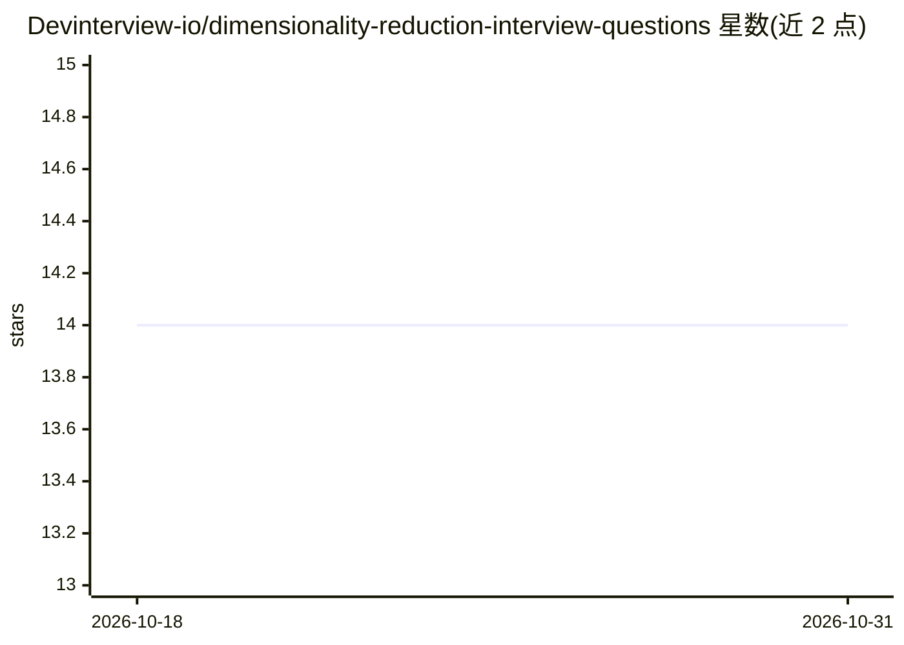

# Devinterview-io/dimensionality-reduction-interview-questions

⭐ 14 · 推送 2026-01-04 · [GitHub](https://github.com/Devinterview-io/dimensionality-reduction-interview-questions) · 组织维护

**降维（Dimensionality Reduction）机器学习面试题与答案合集（50 题）**

Devinterview.io 维护的面试准备知识库：收录 50 道降维主题的机器学习/数据科学面试问答，涵盖降维定义、维数灾难、过拟合缓解、特征选择与特征提取区别、PCA/LDA/t-SNE/UMAP/自编码器等技术的原理讲解，部分题目附带 scikit-learn Python 代码示例。完整答案托管在 Devinterview.io 站点，仓库内为问题与讲解内容，面向准备 2026 年机器学习与数据科学面试的求职者。

## 筛选速览

| 维度 | 判定 | 备注 |
|---|---|---|
| AI 角色 | `ai-knowledge` | 知识聚合/清单类 |
| 许可风险 | `none` | — |
| 部署形态 | `None` |  |
| 模型依赖 | — | README 未给出锁定关系 |
| 硬件要求 | — | 无带数字的原话,不猜 |
| 安装摩擦 | `low` | 无编译、无系统依赖或容器化 |
| 成熟度 | — | 结构信号不足 |

## 能力要点

- 50 道降维主题面试问答
- 覆盖特征选择、特征提取、流形学习、自编码器等技术类别
- 部分题目附 scikit-learn 代码示例（如 PCA 缓解过拟合）

## 适用场景

- 准备机器学习/数据科学岗位的技术面试
- 系统学习降维技术的概念与原理
- 复习 PCA、t-SNE、UMAP 等方法的适用场景

## 场景标签

`教程课程` · 领域:学习与行业

## 证据(README 行号)

> L1: # 50 Must-Know Dimensionality Reduction Interview Questions in 2026
> L7: #### You can also find all 50 answers here 👉 Devinterview.io - Dimensionality Reduction

## 星数曲线

2026-10-18 14 → 2026-10-31 14（+0）

---
*卡片 v1 · prompt 1.4 · 生成 2026-10-31 · 置信度 high · 依据 README sha `1299641d55a5` · [字段定义](../../DATASET.md)*
