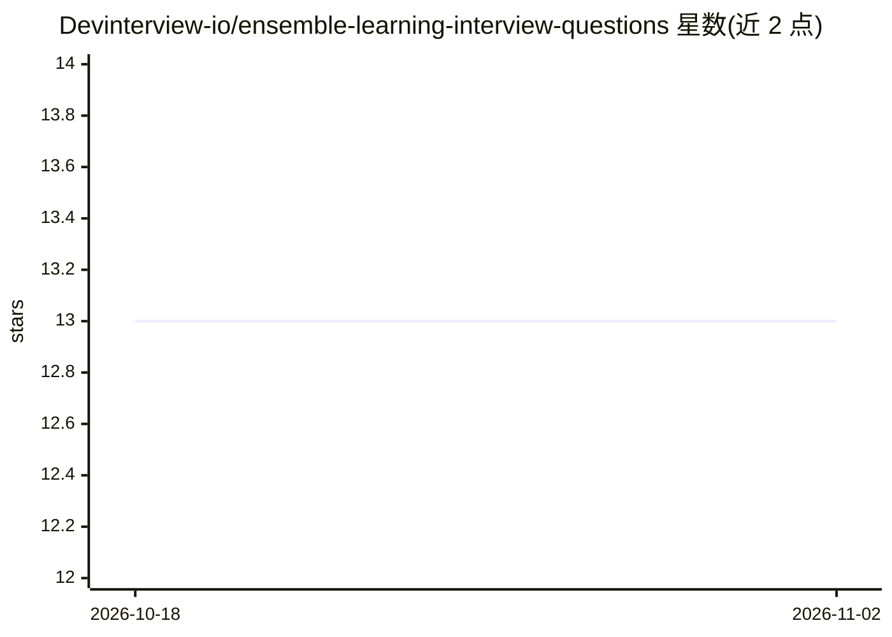

# Devinterview-io/ensemble-learning-interview-questions

⭐ 13 · 推送 2026-01-04 · [GitHub](https://github.com/Devinterview-io/ensemble-learning-interview-questions) · 组织维护

**面向ML面试者的70道集成学习题目与答案索引**

由 Devinterview.io 提供的集成学习面试题内容仓库，面向 2026 年机器学习/数据科学面试准备者。README 展示前几题的概念说明、bagging/boosting/stacking 差异、weak learner 与 bias-variance 等主题，并附 scikit-learn/Python 代码示例；完整 70 题答案需跳转站点查看。仅作学习资料，不含可安装软件。

## 筛选速览

| 维度 | 判定 | 备注 |
|---|---|---|
| AI 角色 | `ai-knowledge` | 知识聚合/清单类 |
| 许可风险 | `none` | — |
| 部署形态 | `None` |  |
| 模型依赖 | — | README 未给出锁定关系 |
| 硬件要求 | — | 无带数字的原话,不猜 |
| 安装摩擦 | `low` | 无编译、无系统依赖或容器化 |
| 成熟度 | — | 结构信号不足 |

## 能力要点

- 收录 70 道集成学习面试问题并链接完整答案站点
- 覆盖 bagging、boosting、stacking、weak learner、bias-variance 等主题
- 题目说明附 Python/scikit-learn 代码示例

## 适用场景

- 准备机器学习/数据科学岗位面试时复习集成学习概念
- 查阅 bagging、boosting、stacking 的差异与代码示例
- 学习 weak learner 与偏差-方差权衡等基础主题

## 场景标签

`教程课程` · 领域:学习与行业

## 证据(README 行号)

> L1: # Top 70 Ensemble Learning Interview Questions in 2026
> L4: machine-learning-and-data-science
> L7: #### You can also find all 70 answers here 👉 Devinterview.io - Ensemble Learning

## 星数曲线

2026-10-18 13 → 2026-11-02 13（+0）

---
*卡片 v1 · prompt 1.4 · 生成 2026-10-31 · 置信度 high · 依据 README sha `3fa2f72562c6` · [字段定义](../../DATASET.md)*
