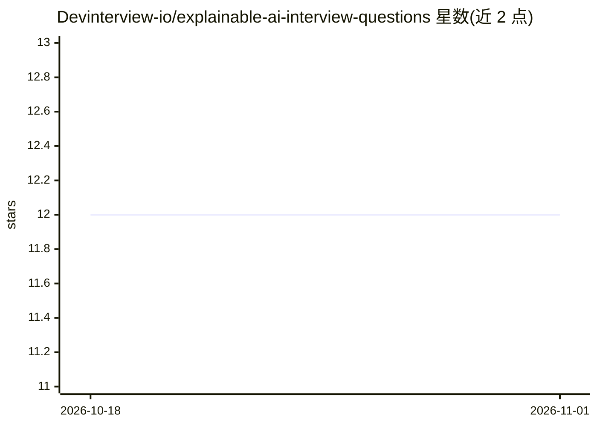

# Devinterview-io/explainable-ai-interview-questions

⭐ 12 · 推送 2026-01-04 · [GitHub](https://github.com/Devinterview-io/explainable-ai-interview-questions) · 组织维护

**可解释 AI（XAI）面试问答集，面向 ML/数据科学求职者**

由 Devinterview.io 维护的可解释 AI 面试题目集合，收录 35 个问答（README 内展示部分），题目覆盖 XAI 概念与重要性、可解释模型与可阐释模型的区别、实施可解释性的 12 项挑战、模型透明度与敏感应用（医疗/金融/司法）的关系，涉及 SHAP、LIME、决策树、随机森林等技术。完整答案托管于 Devinterview.io 网站，仓库本身为 Markdown 文档，无代码或安装过程。

## 筛选速览

| 维度 | 判定 | 备注 |
|---|---|---|
| AI 角色 | `ai-knowledge` | 知识聚合/清单类 |
| 许可风险 | `none` | — |
| 部署形态 | `library` | 以包/库形式分发 |
| 模型依赖 | — | README 未给出锁定关系 |
| 硬件要求 | — | 无带数字的原话,不猜 |
| 安装摩擦 | `low` | 无编译、无系统依赖或容器化 |
| 成熟度 | — | 结构信号不足 |

## 能力要点

- 35 个可解释 AI 面试问答，完整答案在 Devinterview.io
- 覆盖 XAI 概念、技术（SHAP/LIME）、挑战与行业用例
- 以 Markdown 题目文档形式组织，按问题分节

## 适用场景

- 准备机器学习或数据科学岗位面试
- 系统梳理可解释 AI 的概念与技术考点
- 了解 XAI 在医疗、金融等敏感领域的合规要求

## 场景标签

`教程课程` · 领域:学习与行业

## 证据(README 行号)

> L1: # 35 Important Explainable AI Interview Questions in 2026
> L7: #### You can also find all 35 answers here 👉 Devinterview.io - Explainable AI

## 星数曲线

2026-10-18 12 → 2026-11-01 12（+0）

---
*卡片 v1 · prompt 1.4 · 生成 2026-11-01 · 置信度 mid · 依据 README sha `2b1c5289a3aa` · [字段定义](../../DATASET.md)*
