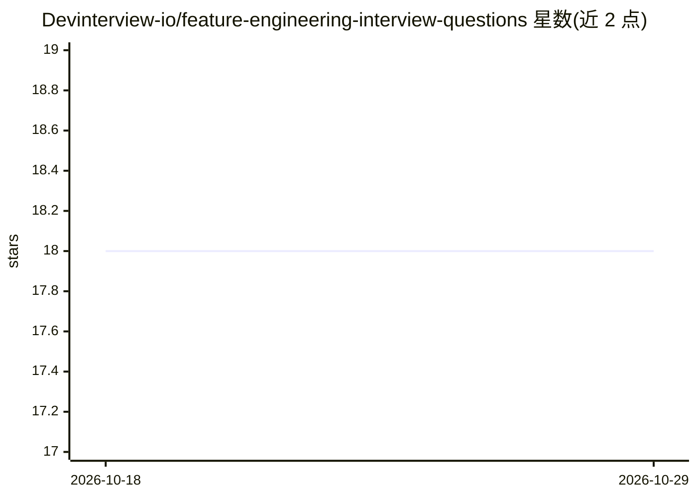

# Devinterview-io/feature-engineering-interview-questions

⭐ 18 · 推送 2026-01-04 · [GitHub](https://github.com/Devinterview-io/feature-engineering-interview-questions) · 组织维护

**特征工程面试题答案集：50 道机器学习面试问答**

Devinterview.io 维护的特征工程面试题集合，含 50 道问答（README 内展示约 5 道完整答案），完整答案需跳转外部网站查看。内容覆盖特征工程定义与影响、特征类别划分、特征选择与特征提取的对比、常见挑战（缺失值、数据泄漏、高基数类别等）及归一化/标准化流程，并附 sklearn Python 代码示例。面向准备机器学习与数据科学面试的求职者，以 Markdown 文档形式阅读使用，无需安装。

## 筛选速览

| 维度 | 判定 | 备注 |
|---|---|---|
| AI 角色 | `ai-knowledge` | 知识聚合/清单类 |
| 许可风险 | `none` | — |
| 部署形态 | `None` |  |
| 模型依赖 | — | README 未给出锁定关系 |
| 硬件要求 | — | 无带数字的原话,不猜 |
| 安装摩擦 | `low` | 无编译、无系统依赖或容器化 |
| 成熟度 | — | 结构信号不足 |

## 能力要点

- 50 道特征工程面试问答，README 内含约 5 道完整答案
- 覆盖特征选择/提取对比、缺失值、数据泄漏等常见考点
- 附 sklearn 特征工程步骤的 Python 代码示例

## 适用场景

- 准备数据科学/机器学习面试时复习特征工程知识
- 系统梳理特征工程的方法类别与常见挑战
- 查看配套 Python 代码示例理解流程

## 场景标签

`教程课程` · 领域:学习与行业

## 证据(README 行号)

> L1: # Top 50 Feature Engineering Interview Questions in 2026
> L7: #### You can also find all 50 answers here 👉 Devinterview.io - Feature Engineering
> L9: ## 1. What is _feature engineering_ and how does it impact the performance of _machine learning models_?

## 星数曲线

2026-10-18 18 → 2026-10-29 18（+0）

---
*卡片 v1 · prompt 1.4 · 生成 2026-10-29 · 置信度 high · 依据 README sha `043b37d9e40f` · [字段定义](../../DATASET.md)*
