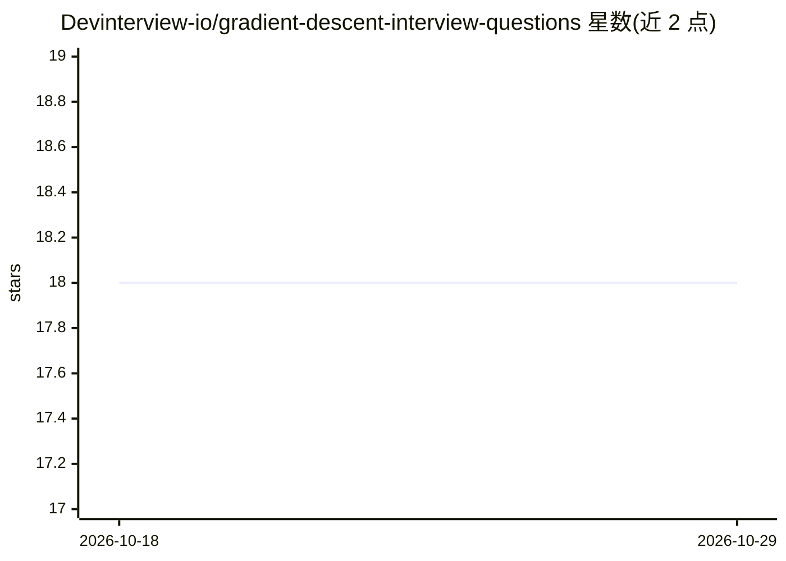

# Devinterview-io/gradient-descent-interview-questions

⭐ 18 · 推送 2026-01-04 · [GitHub](https://github.com/Devinterview-io/gradient-descent-interview-questions) · 组织维护

**梯度下降机器学习面试题与答案合集（50 题）**

Devinterview.io 维护的面试题清单仓库，收录 50 道梯度下降相关问答，覆盖基本原理、SGD/Mini-batch/Momentum/RMSprop/Adam 等变体、学习率选择与局部最小值等主题。每题以 Markdown 组织，含公式推导、直觉解释与 Python 代码示例（部分用到 TensorFlow/Keras）。完整答案托管在 Devinterview.io 站点，仓库内仅展示部分题目内容。面向准备机器学习与数据科学面试的求职者。

## 筛选速览

| 维度 | 判定 | 备注 |
|---|---|---|
| AI 角色 | `ai-knowledge` | 知识聚合/清单类 |
| 许可风险 | `none` | — |
| 部署形态 | `None` |  |
| 模型依赖 | — | README 未给出锁定关系 |
| 硬件要求 | — | 无带数字的原话,不猜 |
| 安装摩擦 | `low` | 无编译、无系统依赖或容器化 |
| 成熟度 | — | 结构信号不足 |

## 能力要点

- 50 道梯度下降主题面试问答
- 每题含公式推导、直觉解释与 Python 代码示例
- 覆盖 SGD、Momentum、RMSprop、Adam 等优化算法变体
- 完整答案链接至 Devinterview.io

## 适用场景

- 准备机器学习/数据科学技术面试
- 复习梯度下降及优化算法基础概念
- 作为面试官出题参考题库

## 场景标签

`教程课程` · 领域:学习与行业

## 证据(README 行号)

> L1: # 50 Fundamental Gradient Descent Interview Questions in 2026
> L7: #### You can also find all 50 answers here 👉 Devinterview.io - Gradient Descent

## 星数曲线

2026-10-18 18 → 2026-10-29 18（+0）

---
*卡片 v1 · prompt 1.4 · 生成 2026-10-29 · 置信度 high · 依据 README sha `e85815dc837d` · [字段定义](../../DATASET.md)*
