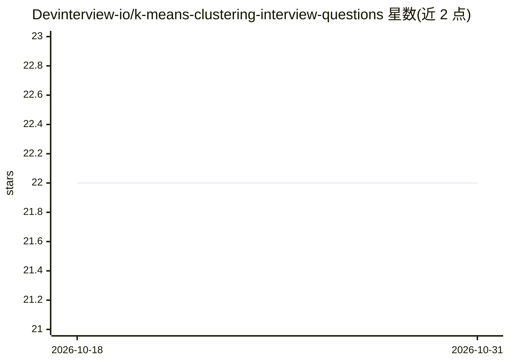

# Devinterview-io/k-means-clustering-interview-questions

⭐ 22 · 推送 2026-01-04 · [GitHub](https://github.com/Devinterview-io/k-means-clustering-interview-questions) · 组织维护

**K-Means 聚类面试题集（50 题含答案）**

Devinterview.io 维护的机器学习/数据科学面试准备资料仓库，以问答形式覆盖 K-Means 聚类主题：算法原理、质心与 WCSS 计算、距离度量（欧氏/曼哈顿/切比雪夫/Minkowski）、簇数 k 选择方法（肘部法/轮廓系数/Gap Statistic/树状图等）、质心初始化（K-Means++/随机）及分类数据适配（Gower 距离），部分问题附 Python/sklearn 代码示例。面向准备数据科学面试的求职者，完整 50 题答案指向 Devinterview.io 网站。

## 筛选速览

| 维度 | 判定 | 备注 |
|---|---|---|
| AI 角色 | `ai-knowledge` | 知识聚合/清单类 |
| 许可风险 | `none` | — |
| 部署形态 | `None` |  |
| 模型依赖 | — | README 未给出锁定关系 |
| 硬件要求 | — | 无带数字的原话,不猜 |
| 安装摩擦 | `low` | 无编译、无系统依赖或容器化 |
| 成熟度 | — | 结构信号不足 |

## 能力要点

- 50 道 K-Means 聚类面试问答
- 涵盖距离度量、k 选择、质心初始化等主题
- 部分问题附 Python/sklearn 代码示例

## 适用场景

- 准备数据科学/机器学习面试的 K-Means 相关考点
- 系统复习聚类算法原理与评估方法
- 通过代码示例理解 K-Means 实现细节

## 场景标签

`教程课程` · 领域:学习与行业

## 证据(README 行号)

> L1: # 50 Common K-Means Clustering Interview Questions in 2026
> L7: #### You can also find all 50 answers here 👉 Devinterview.io - K-Means Clustering

## 星数曲线

2026-10-18 22 → 2026-10-31 22（+0）

---
*卡片 v1 · prompt 1.4 · 生成 2026-10-27 · 置信度 high · 依据 README sha `9bdb78d8dea7` · [字段定义](../../DATASET.md)*
