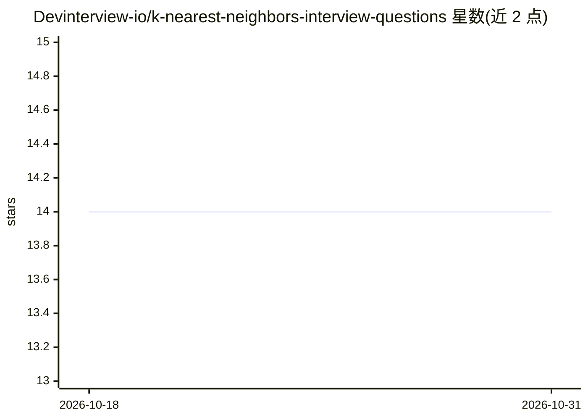

# Devinterview-io/k-nearest-neighbors-interview-questions

⭐ 14 · 推送 2026-01-04 · [GitHub](https://github.com/Devinterview-io/k-nearest-neighbors-interview-questions) · 组织维护

**K 近邻算法面试题库：45 题+答案供 ML/数据科学面试备考**

Devinterview.io 的 K-Nearest Neighbors（K-NN）面试题仓库，提供 45 道问答，README 内展示其中部分问题与解答，完整答案在 Devinterview.io 网站上。内容覆盖 K-NN 原理（非参数、基于实例的学习）、分类与回归步骤、K 值选择方法（肘部法、交叉验证、网格搜索）、优缺点、距离度量（欧氏、曼哈顿、闵可夫斯基）及不适用场景（维度灾难、不平衡数据），并附 scikit-learn 代码示例。面向准备机器学习与数据科学面试的求职者，纯文档内容，无需安装运行。

## 筛选速览

| 维度 | 判定 | 备注 |
|---|---|---|
| AI 角色 | `ai-knowledge` | 知识聚合/清单类 |
| 许可风险 | `none` | — |
| 部署形态 | `None` |  |
| 模型依赖 | — | README 未给出锁定关系 |
| 硬件要求 | — | 无带数字的原话,不猜 |
| 安装摩擦 | `low` | 无编译、无系统依赖或容器化 |
| 成熟度 | — | 结构信号不足 |

## 能力要点

- 45 道 K-NN 面试问答，完整答案托管于 Devinterview.io
- 覆盖分类/回归原理、K 值选择、距离度量与局限性
- 附 scikit-learn KNeighborsClassifier/Regressor 代码示例

## 适用场景

- 准备机器学习/数据科学岗位面试时复习 K-NN 知识点
- 学习 K-NN 算法原理与调参方法
- 查找示例代码理解 K-NN 在分类与回归中的应用

## 场景标签

`教程课程` · 领域:学习与行业

## 证据(README 行号)

> L1: # 45 Must-Know K-Nearest Neighbors Interview Questions in 2026
> L7: #### You can also find all 45 answers here 👉 Devinterview.io - K-Nearest Neighbors

## 星数曲线

2026-10-18 14 → 2026-10-31 14（+0）

---
*卡片 v1 · prompt 1.4 · 生成 2026-10-31 · 置信度 high · 依据 README sha `bbee62516cae` · [字段定义](../../DATASET.md)*
