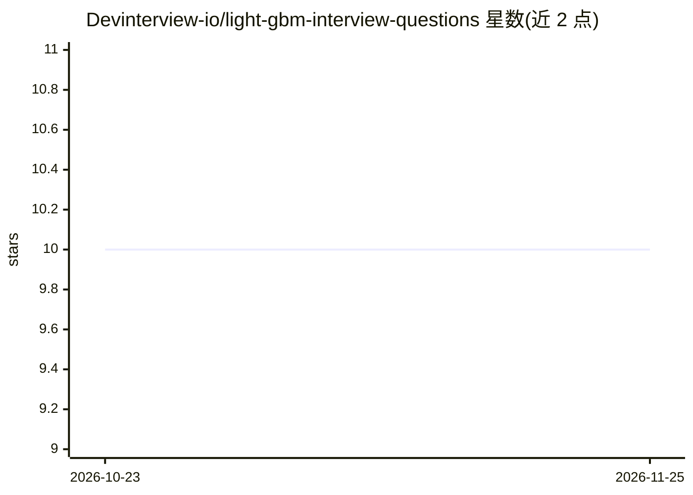

# Devinterview-io/light-gbm-interview-questions

⭐ 10 · 推送 2026-01-04 · [GitHub](https://github.com/Devinterview-io/light-gbm-interview-questions) · 组织维护

**面向求职者的 45 道 LightGBM 面试题与答案集**

Devinterview.io 机器学习/数据科学面试题库中的 LightGBM 专题，收录 45 道面试题。内容以问答形式讲解 LightGBM 的核心机制，包括 leaf-wise 树生长策略、基于直方图的分裂点搜索、GOSS 单侧梯度采样、EFB 类别特征捆绑、与 XGBoost/CatBoost 的处理差异等，并附 Python 代码示例。答案全集托管在 Devinterview.io 网站，README 展示问题及部分详细解答。

## 筛选速览

| 维度 | 判定 | 备注 |
|---|---|---|
| AI 角色 | `ai-knowledge` | 知识聚合/清单类 |
| 许可风险 | `none` | — |
| 部署形态 | `None` |  |
| 模型依赖 | — | README 未给出锁定关系 |
| 硬件要求 | — | 无带数字的原话,不猜 |
| 安装摩擦 | `low` | 无编译、无系统依赖或容器化 |
| 成熟度 | — | 结构信号不足 |

## 能力要点

- 45 道 LightGBM 面试题（2026 版）
- 覆盖 leaf-wise 生长、直方图分裂、GOSS、EFB 等核心机制
- 附 Python 代码示例（XGBoost 与 LightGBM 对比写法）

## 适用场景

- 准备机器学习/数据科学岗位的 LightGBM 相关面试
- 复习梯度提升框架的核心算法概念
- 查看类别特征处理等知识点的代码示例

## 场景标签

`教程课程` · 领域:学习与行业

## 证据(README 行号)

> L1: # 45 Must-Know LightGBM Interview Questions in 2026
> L7: #### You can also find all 45 answers here 👉 Devinterview.io - LightGBM

## 星数曲线

2026-10-23 10 → 2026-11-25 10（+0）

---
*卡片 v1 · prompt 1.4 · 生成 2026-11-20 · 置信度 high · 依据 README sha `a7fd5d5946d8` · [字段定义](../../DATASET.md)*
