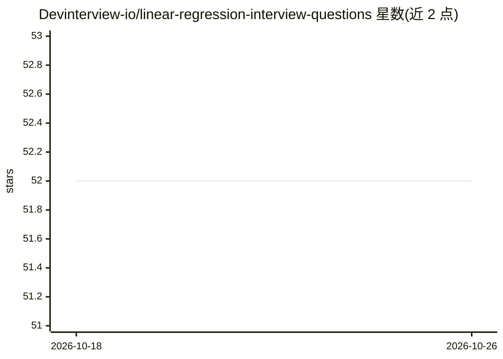

# Devinterview-io/linear-regression-interview-questions

⭐ 52 · 推送 2026-01-04 · [GitHub](https://github.com/Devinterview-io/linear-regression-interview-questions) · 组织维护

**线性回归面试题问答集（70 题），面向机器学习面试备考**

Devinterview.io 维护的线性回归主题面试问答集合：README 内列出 70 道线性回归面试题的部分题目与答案，覆盖定义、假设、系数解释、截距项、评估指标（MAE/MSE/RMSE/R²）等主题，并附 Python/sklearn 代码示例；完整答案需访问 Devinterview.io 网站。面向准备机器学习与数据科学面试的求职者，内容为纯文档，无需安装运行。

## 筛选速览

| 维度 | 判定 | 备注 |
|---|---|---|
| AI 角色 | `ai-knowledge` | 知识聚合/清单类 |
| 许可风险 | `none` | — |
| 部署形态 | `None` |  |
| 模型依赖 | — | README 未给出锁定关系 |
| 硬件要求 | — | 无带数字的原话,不猜 |
| 安装摩擦 | `low` | 无编译、无系统依赖或容器化 |
| 成熟度 | — | 结构信号不足 |

## 能力要点

- 70 道线性回归面试题及部分答案
- 覆盖模型假设、系数解释、截距、评估指标等主题
- 附 Python/sklearn 代码示例

## 适用场景

- 备考机器学习/数据科学面试时复习线性回归
- 查 skim 线性回归关键概念与公式定义
- 参考 Python 代码示例理解模型用法

## 场景标签

`教程课程` · 领域:学习与行业

## 证据(README 行号)

> L1: # 70 Must-Know Linear Regression Interview Questions in 2026
> L7: #### You can also find all 70 answers here 👉 Devinterview.io - Linear Regression

## 星数曲线

2026-10-18 52 → 2026-10-26 52（+0）

---
*卡片 v1 · prompt 1.4 · 生成 2026-10-24 · 置信度 high · 依据 README sha `4e2173211da6` · [字段定义](../../DATASET.md)*
