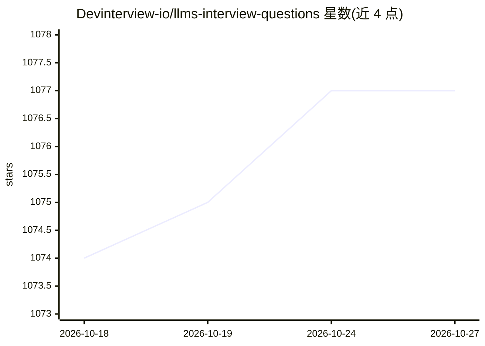

# Devinterview-io/llms-interview-questions

⭐ 1,077 · 推送 2026-02-17 · [GitHub](https://github.com/Devinterview-io/llms-interview-questions) · 组织维护

**面向求职者的 LLM 机器学习面试题与答案合集（63 题）**

由 Devinterview.io 维护的 LLM 面试问答知识库：收录 63 道 LLM 相关面试题及解答，覆盖 Transformer 架构、注意力机制、RoPE/GQA/SwIGLU 等现代组件、训练流程（预训练/SFT/DPO/LoRA）、LLM 与传统统计语言模型的对比等内容。答案以 Markdown 与 Python/PyTorch 示例代码呈现，完整答案托管于 Devinterview.io 站点。本仓库仅含文档，无安装或运行需求。

## 筛选速览

| 维度 | 判定 | 备注 |
|---|---|---|
| AI 角色 | `ai-knowledge` | 知识聚合/清单类 |
| 许可风险 | `none` | — |
| 部署形态 | `None` |  |
| 模型依赖 | — | README 未给出锁定关系 |
| 硬件要求 | — | 无带数字的原话,不猜 |
| 安装摩擦 | `medium` | 含编译或系统依赖之一 |
| 成熟度 | — | 结构信号不足 |

## 能力要点

- 63 道 LLM 主题面试题及答案
- 覆盖 Transformer 架构、注意力机制与训练流程
- 答案含 PyTorch 代码示例（GQA、SwiGLU 等）
- 完整答案链接至 Devinterview.io

## 适用场景

- 准备机器学习/数据科学面试中 LLM 相关问题
- 系统复习 Transformer 与 LLM 核心概念
- 作为 LLM 技术知识的学习参考资料

## 场景标签

`教程课程` · 领域:学习与行业

## 证据(README 行号)

> L1: # 63 Must-Know LLMs Interview Questions in 2026
> L7: #### You can also find all 63 answers here 👉 Devinterview.io - LLMs

## 星数曲线

2026-10-18 1,074 → 2026-10-27 1,077（+3）

---
*卡片 v1 · prompt 1.4 · 生成 2026-10-21 · 置信度 high · 依据 README sha `92bd9045d57e` · [字段定义](../../DATASET.md)*
