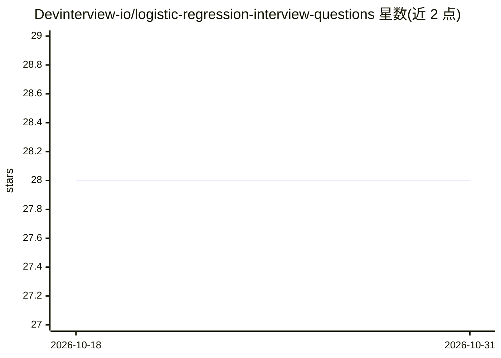

# Devinterview-io/logistic-regression-interview-questions

⭐ 28 · 推送 2026-01-04 · [GitHub](https://github.com/Devinterview-io/logistic-regression-interview-questions) · 组织维护

**面向求职者的逻辑回归面试题与答案合集（50 题）**

Devinterview.io 维护的机器学习/数据科学面试准备资料仓库：以问答形式覆盖逻辑回归的核心概念，包括与线性回归的差异、sigmoid 与 logit 函数、决策边界与阈值、二元交叉熵损失、多分类策略（OvR/OvO）、模型假设与 L1 正则化特征选择等，部分问题附 Python 代码示例。完整 50 题答案需跳转 Devinterview.io 站点查看。面向准备 2026 年机器学习与数据科学面试的求职者，无需安装运行，属纯文档内容。

## 筛选速览

| 维度 | 判定 | 备注 |
|---|---|---|
| AI 角色 | `ai-knowledge` | 知识聚合/清单类 |
| 许可风险 | `none` | — |
| 部署形态 | `None` |  |
| 模型依赖 | — | README 未给出锁定关系 |
| 硬件要求 | — | 无带数字的原话,不猜 |
| 安装摩擦 | `low` | 无编译、无系统依赖或容器化 |
| 成熟度 | — | 结构信号不足 |

## 能力要点

- 50 道逻辑回归面试问答，覆盖概念、数学推导与评估指标
- 部分问题附 Python 代码示例（sigmoid、logit 变换等）
- 完整答案在 Devinterview.io 站点提供链接

## 适用场景

- 准备机器学习或数据科学岗位的技术面试
- 复习逻辑回归的数学原理与假设条件
- 查找逻辑回归常见面试考点及参考答案

## 场景标签

`教程课程` · 领域:学习与行业

## 证据(README 行号)

> L1: # 50 Core Logistic Regression Interview Questions in 2026
> L7: #### You can also find all 50 answers here 👉 Devinterview.io - Logistic Regression

## 星数曲线

2026-10-18 28 → 2026-10-31 28（+0）

---
*卡片 v1 · prompt 1.4 · 生成 2026-10-26 · 置信度 high · 依据 README sha `9d8c5aa3b8a8` · [字段定义](../../DATASET.md)*
