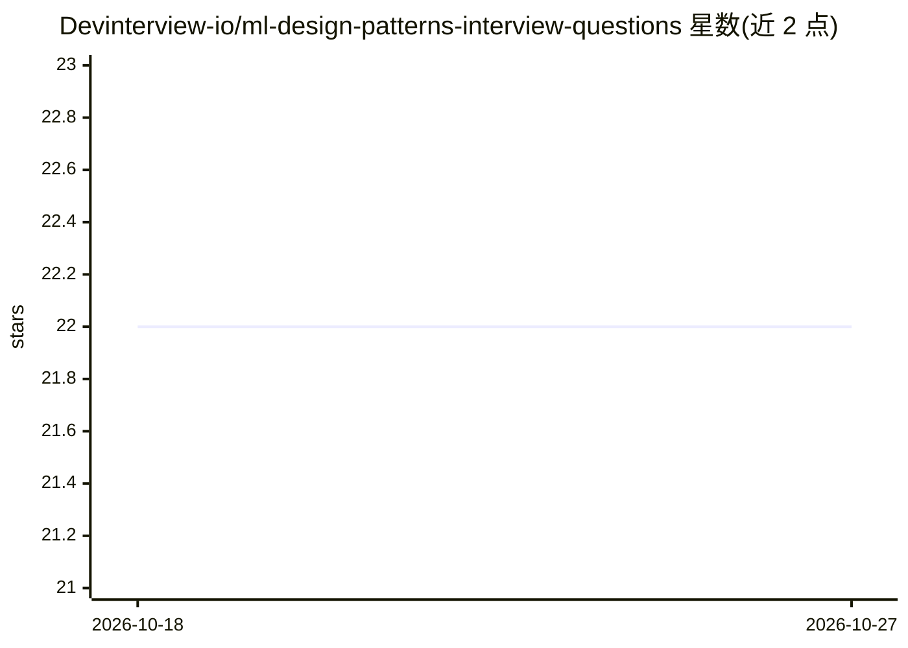

# Devinterview-io/ml-design-patterns-interview-questions

⭐ 22 · 推送 2026-01-04 · [GitHub](https://github.com/Devinterview-io/ml-design-patterns-interview-questions) · 组织维护

**面向求职者的 ML 设计模式面试题库（70 题，含答案）**

Devinterview.io 维护的机器学习设计模式面试问答仓库，收录 70 道题目，README 展示前 7 题及部分答案，主题涵盖 Baseline、Feature Store、Pipelines、Replay、Model Ensemble、Checkpoint 等设计模式，每题附概念讲解与 Python 代码示例（基于 scikit-learn、TensorFlow/Keras）。完整答案托管于 Devinterview.io 网站。仓库本身为文档内容，无安装或运行方式，面向准备机器学习与数据科学面试的求职者。

## 筛选速览

| 维度 | 判定 | 备注 |
|---|---|---|
| AI 角色 | `ai-knowledge` | 知识聚合/清单类 |
| 许可风险 | `none` | — |
| 部署形态 | `None` |  |
| 模型依赖 | — | README 未给出锁定关系 |
| 硬件要求 | — | 无带数字的原话,不猜 |
| 安装摩擦 | `low` | 无编译、无系统依赖或容器化 |
| 成熟度 | — | 结构信号不足 |

## 能力要点

- 收录 70 道 ML 设计模式面试题，完整答案在 Devinterview.io
- 题目覆盖 Baseline、Feature Store、Pipelines、Replay、Ensemble、Checkpoint 等模式
- 每题附概念要点与 scikit-learn/TensorFlow 代码示例

## 适用场景

- 准备机器学习/数据科学岗位的技术面试
- 系统学习 ML 系统设计模式的常见考点
- 复习特征存储、训练流水线、模型集成等工程概念

## 场景标签

`教程课程` · 领域:学习与行业

## 证据(README 行号)

> L1: # 70 Important ML Design Patterns Interview Questions in 2026
> L7: #### You can also find all 70 answers here 👉 Devinterview.io - ML Design Patterns

## 星数曲线

2026-10-18 22 → 2026-10-27 22（+0）

---
*卡片 v1 · prompt 1.4 · 生成 2026-10-27 · 置信度 high · 依据 README sha `7ffd4620d46f` · [字段定义](../../DATASET.md)*
