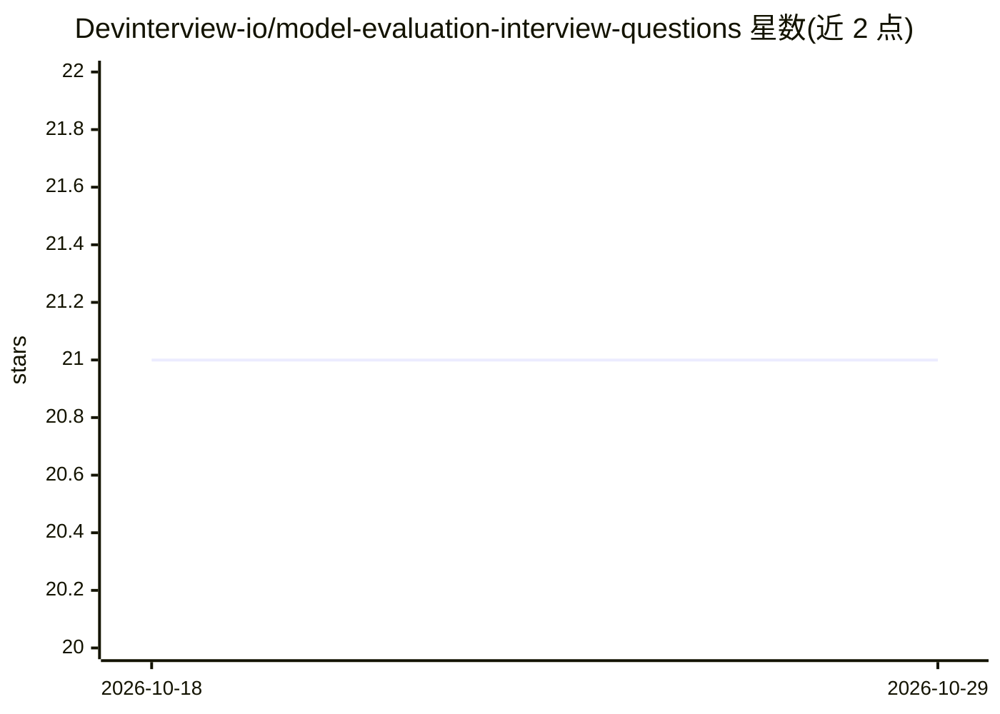

# Devinterview-io/model-evaluation-interview-questions

⭐ 21 · 推送 2026-01-04 · [GitHub](https://github.com/Devinterview-io/model-evaluation-interview-questions) · 组织维护

**模型评估面试题库：55 问答案助准备 ML/数据科学面试**

Devinterview.io 维护的机器学习模型评估主题面试问答集，覆盖 55 个问题及答案，主题包括模型评估定义、训练/验证/测试集划分、交叉验证（K-Fold、分层、LOOCV、重复 K-Fold）、precision/recall/F1、混淆矩阵与 ROC/AUC 等。答案以文字解释配合 scikit-learn Python 代码示例呈现。面向准备机器学习与数据科学面试的求职者，完整答案在 Devinterview.io 网站查看。

## 筛选速览

| 维度 | 判定 | 备注 |
|---|---|---|
| AI 角色 | `ai-knowledge` | 知识聚合/清单类 |
| 许可风险 | `none` | — |
| 部署形态 | `None` |  |
| 模型依赖 | — | README 未给出锁定关系 |
| 硬件要求 | — | 无带数字的原话,不猜 |
| 安装摩擦 | `low` | 无编译、无系统依赖或容器化 |
| 成熟度 | — | 结构信号不足 |

## 能力要点

- 55 个模型评估主题面试问题及答案
- 覆盖交叉验证、评估指标、混淆矩阵、ROC/AUC 等主题
- 答案配 scikit-learn Python 代码示例

## 适用场景

- 准备机器学习/数据科学面试时复习模型评估知识
- 学习模型评估指标与交叉验证技术并查看代码实现
- 面试官引用题目作为候选人考核材料

## 场景标签

`教程课程` · 领域:学习与行业

## 证据(README 行号)

> L1: # 55 Core Model Evaluation Interview Questions in 2026
> L7: #### You can also find all 55 answers here 👉 Devinterview.io - Model Evaluation

## 星数曲线

2026-10-18 21 → 2026-10-29 21（+0）

---
*卡片 v1 · prompt 1.4 · 生成 2026-10-28 · 置信度 high · 依据 README sha `186776a2ba61` · [字段定义](../../DATASET.md)*
