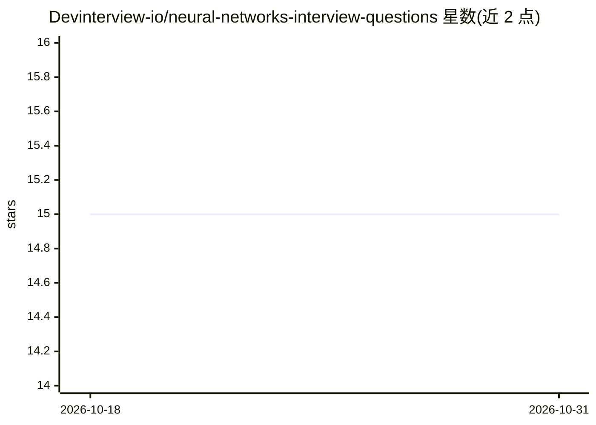

# Devinterview-io/neural-networks-interview-questions

⭐ 15 · 推送 2026-01-04 · [GitHub](https://github.com/Devinterview-io/neural-networks-interview-questions) · 组织维护

**神经网络面试题库：95 道问答助备机器学习面试**

Devinterview.io 维护的神经网络面试问答知识库，覆盖神经元结构、多层感知机、前馈与循环网络、反向传播、激活函数等主题，答案包含概念讲解、数学公式与 Python 代码示例（基于 numpy）。面向准备机器学习与数据科学面试的求职者，完整 95 题答案托管在 Devinterview.io 网站，本仓库以 Markdown 文档形式呈现部分内容。

## 筛选速览

| 维度 | 判定 | 备注 |
|---|---|---|
| AI 角色 | `ai-knowledge` | 知识聚合/清单类 |
| 许可风险 | `none` | — |
| 部署形态 | `None` |  |
| 模型依赖 | — | README 未给出锁定关系 |
| 硬件要求 | — | 无带数字的原话,不猜 |
| 安装摩擦 | `low` | 无编译、无系统依赖或容器化 |
| 成熟度 | — | 结构信号不足 |

## 能力要点

- 95 道神经网络面试题问答（2026 版）
- 答案配数学公式与 Python 代码示例
- 覆盖 MLP、RNN、反向传播、激活函数等基础主题

## 适用场景

- 准备机器学习/数据科学岗位的技术面试
- 系统复习神经网络核心概念与原理
- 通过代码示例理解激活函数等实现细节

## 场景标签

`教程课程` · 领域:学习与行业

## 证据(README 行号)

> L1: # 95 Common Neural Networks Interview Questions in 2026
> L7: #### You can also find all 95 answers here 👉 Devinterview.io - Neural Networks

## 星数曲线

2026-10-18 15 → 2026-10-31 15（+0）

---
*卡片 v1 · prompt 1.4 · 生成 2026-10-30 · 置信度 high · 依据 README sha `c1329e39511c` · [字段定义](../../DATASET.md)*
