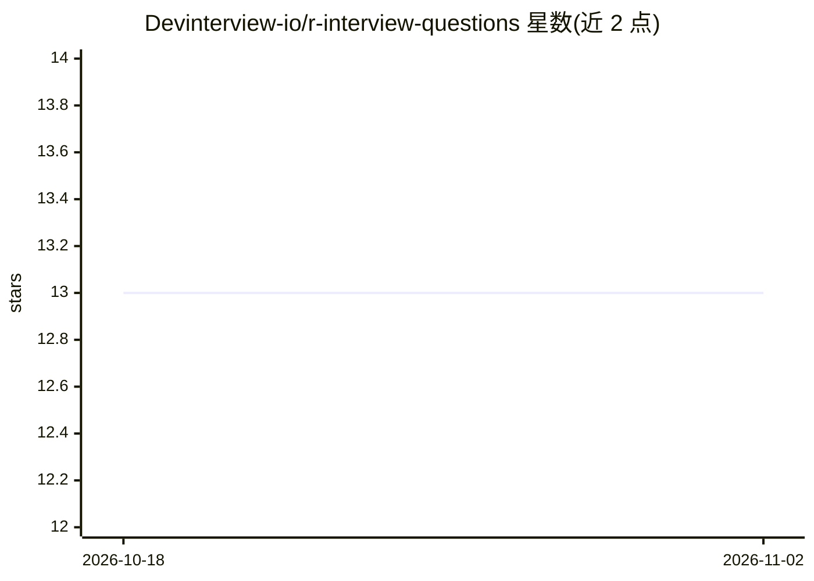

# Devinterview-io/r-interview-questions

⭐ 13 · 推送 2026-01-04 · [GitHub](https://github.com/Devinterview-io/r-interview-questions) · 组织维护

**R 语言机器学习/数据科学面试题与答案集合**

由 Devinterview.io 维护的 R 语言面试准备资料库：收录 60 道 R 面试问答，覆盖数据类型、类型转换、列表与数据框差异、缺失值处理、apply 函数族、变量作用域等主题，并链接到站点上的完整答案。内容面向准备机器学习与数据科学岗位面试的求职者，以 Markdown 文档形式呈现，包含 R 代码示例。仓库本身为纯文档，不提供可运行的软件或安装步骤。

## 筛选速览

| 维度 | 判定 | 备注 |
|---|---|---|
| AI 角色 | `ai-knowledge` | 知识聚合/清单类 |
| 许可风险 | `none` | — |
| 部署形态 | `None` |  |
| 模型依赖 | — | README 未给出锁定关系 |
| 硬件要求 | — | 无带数字的原话,不猜 |
| 安装摩擦 | `low` | 无编译、无系统依赖或容器化 |
| 成熟度 | — | 结构信号不足 |

## 能力要点

- 60 道 R 面试问答条目
- 主题覆盖数据类型、数据框操作、apply 函数族等
- 含 R 代码示例并链接到完整答案站点

## 适用场景

- 准备数据科学岗位的 R 语言技术面试
- 快速回顾 R 语言核心语法与数据处理概念
- 了解机器学习面试中常见的 R 相关考点

## 场景标签

`教程课程` · 领域:学习与行业

## 证据(README 行号)

> L1: # Top 60 R Interview Questions in 2026
> L7: #### You can also find all 60 answers here 👉 Devinterview.io - R

## 星数曲线

2026-10-18 13 → 2026-11-02 13（+0）

---
*卡片 v1 · prompt 1.4 · 生成 2026-10-31 · 置信度 high · 依据 README sha `7ae7288a1ac9` · [字段定义](../../DATASET.md)*
