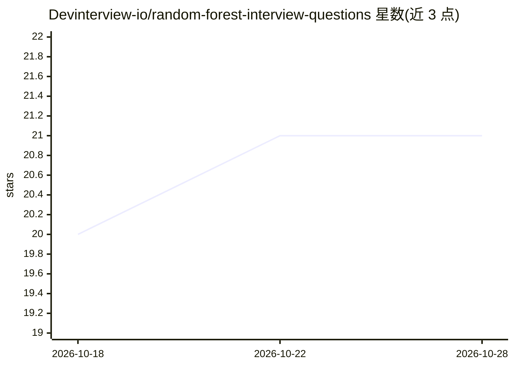

# Devinterview-io/random-forest-interview-questions

⭐ 21 · 推送 2026-01-04 · [GitHub](https://github.com/Devinterview-io/random-forest-interview-questions) · 组织维护

**随机森林面试题库：50 道机器学习面试问答**

Devinterview.io 维护的 Random Forest 主题面试题问答集合，覆盖 2026 年 50 道必知题目：概念定义、bagging 与特征随机性、OOB 误差、与单棵决策树的差异、优缺点及超参数调优等。每题给出文字讲解并附 scikit-learn Python 代码示例，完整答案链接至 Devinterview.io 站点。面向准备机器学习与数据科学面试的求职者，内容为静态知识文档，不提供可安装或可运行的软件。

## 筛选速览

| 维度 | 判定 | 备注 |
|---|---|---|
| AI 角色 | `ai-knowledge` | 知识聚合/清单类 |
| 许可风险 | `none` | — |
| 部署形态 | `None` |  |
| 模型依赖 | — | README 未给出锁定关系 |
| 硬件要求 | — | 无带数字的原话,不猜 |
| 安装摩擦 | `low` | 无编译、无系统依赖或容器化 |
| 成熟度 | — | 结构信号不足 |

## 能力要点

- 50 道 Random Forest 面试问答，含概念与原理讲解
- 附 scikit-learn RandomForestClassifier 代码示例
- 覆盖 bagging、特征随机性、OOB 误差、优缺点对比等主题

## 适用场景

- 准备数据科学/机器学习面试时复习随机森林知识点
- 对照代码示例理解 Random Forest 的训练与预测流程
- 学习 bagging 与集成学习的基础概念

## 场景标签

`教程课程` · 领域:学习与行业

## 证据(README 行号)

> L1: # 50 Must-Know Random Forest Interview Questions in 2026
> L7: #### You can also find all 50 answers here 👉 Devinterview.io - Random Forest

## 星数曲线

2026-10-18 20 → 2026-10-28 21（+1）

---
*卡片 v1 · prompt 1.4 · 生成 2026-10-28 · 置信度 high · 依据 README sha `72c0cc7d3843` · [字段定义](../../DATASET.md)*
