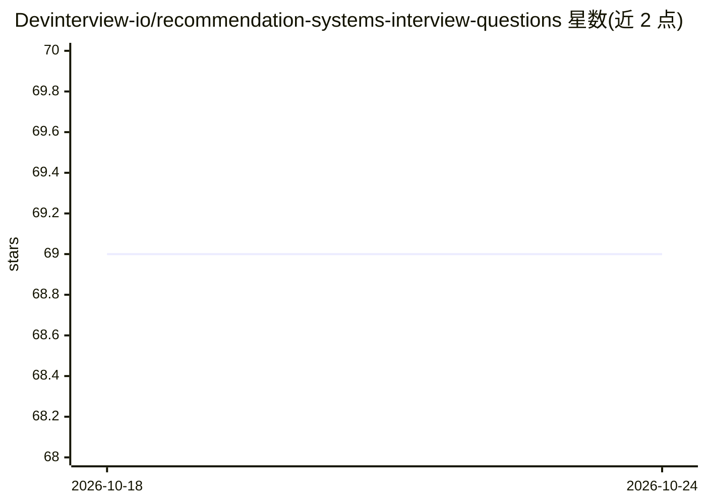

# Devinterview-io/recommendation-systems-interview-questions

⭐ 69 · 推送 2026-01-04 · [GitHub](https://github.com/Devinterview-io/recommendation-systems-interview-questions) · 组织维护

**推荐系统面试题与答案合集（50 题），面向机器学习求职者**

Devinterview.io 维护的推荐系统面试准备资料库：以问答形式覆盖推荐系统定义、协同过滤与基于内容过滤的对比、构建挑战（冷启动、稀疏性、可扩展性、公平性等）主题，包含 SVD 矩阵分解原理、k-NN、TF-IDF、混合系统等算法说明及 Python 代码示例。完整 50 题答案指向 Devinterview.io 网站阅读，仓库本身展示部分问答内容。面向准备机器学习与数据科学面试的求职者，内容为文档形式，无需安装运行。

## 筛选速览

| 维度 | 判定 | 备注 |
|---|---|---|
| AI 角色 | `ai-knowledge` | 知识聚合/清单类 |
| 许可风险 | `none` | — |
| 部署形态 | `None` |  |
| 模型依赖 | — | README 未给出锁定关系 |
| 硬件要求 | — | 无带数字的原话,不猜 |
| 安装摩擦 | `low` | 无编译、无系统依赖或容器化 |
| 成熟度 | — | 结构信号不足 |

## 能力要点

- 覆盖协同过滤/基于内容过滤/混合系统三大范式的问答
- 包含 SVD 矩阵分解、k-NN、TF-IDF 等算法说明
- 冷启动、稀疏性、公平性与可解释性等挑战的讨论
- 附 Python 矩阵因子分解代码示例

## 适用场景

- 准备机器学习/数据科学岗位的推荐系统面试题
- 复习推荐系统核心概念与常见挑战
- 查漏补缺了解冷启动等问题的缓解策略

## 场景标签

`教程课程` · 领域:学习与行业

## 证据(README 行号)

> L1: # 50 Fundamental Recommendation Systems Interview Questions in 2026
> L7: #### You can also find all 50 answers here 👉 Devinterview.io - Recommendation Systems

## 星数曲线

2026-10-18 69 → 2026-10-24 69（+0）

---
*卡片 v1 · prompt 1.4 · 生成 2026-10-24 · 置信度 high · 依据 README sha `be65d473e6c6` · [字段定义](../../DATASET.md)*
