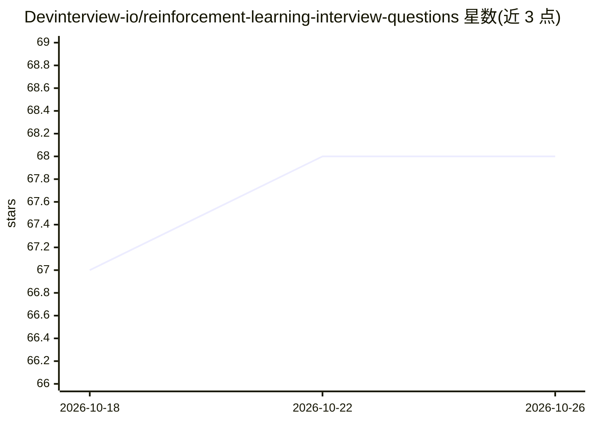

# Devinterview-io/reinforcement-learning-interview-questions

⭐ 68 · 推送 2026-01-04 · [GitHub](https://github.com/Devinterview-io/reinforcement-learning-interview-questions) · 组织维护

**强化学习面试题库：70 道问答备考 ML/DS 面试**

由 Devinterview.io 维护的强化学习面试题解集合，收录 70 道问答，覆盖 RL 与监督/无监督学习的区别、MDP、策略、价值函数、on-policy/off-policy 学习等主题。每题以问答形式组织，含数学公式、术语定义与 Python 代码示例；完整答案托管在 Devinterview.io 站点，仓库内提供部分内容。面向准备机器学习与数据科学面试的求职者，属知识性资料仓库，无安装运行过程。

## 筛选速览

| 维度 | 判定 | 备注 |
|---|---|---|
| AI 角色 | `ai-knowledge` | 知识聚合/清单类 |
| 许可风险 | `none` | — |
| 部署形态 | `None` |  |
| 模型依赖 | — | README 未给出锁定关系 |
| 硬件要求 | — | 无带数字的原话,不猜 |
| 安装摩擦 | `low` | 无编译、无系统依赖或容器化 |
| 成熟度 | — | 结构信号不足 |

## 能力要点

- 70 道强化学习面试问答，按主题编号组织
- 含数学公式（价值函数、MDP 动力学）与 Python 代码示例
- 完整答案链接至 Devinterview.io 站点

## 适用场景

- 准备机器学习/数据科学岗位面试时复习强化学习概念
- 快速查阅 RL 核心术语（agent/MDP/策略/价值函数）的定义与区分
- 借助代码示例理解确定性/随机策略实现

## 场景标签

`教程课程` · 领域:学习与行业

## 证据(README 行号)

> L1: # Top 70 Reinforcement Learning Interview Questions in 2026
> L7: #### You can also find all 70 answers here 👉 Devinterview.io - Reinforcement Learning
> L9: ## 1. What is _reinforcement learning_, and how does it differ from _supervised_ and _unsupervised learning_?

## 星数曲线

2026-10-18 67 → 2026-10-26 68（+1）

---
*卡片 v1 · prompt 1.4 · 生成 2026-10-24 · 置信度 high · 依据 README sha `91a97730eb46` · [字段定义](../../DATASET.md)*
