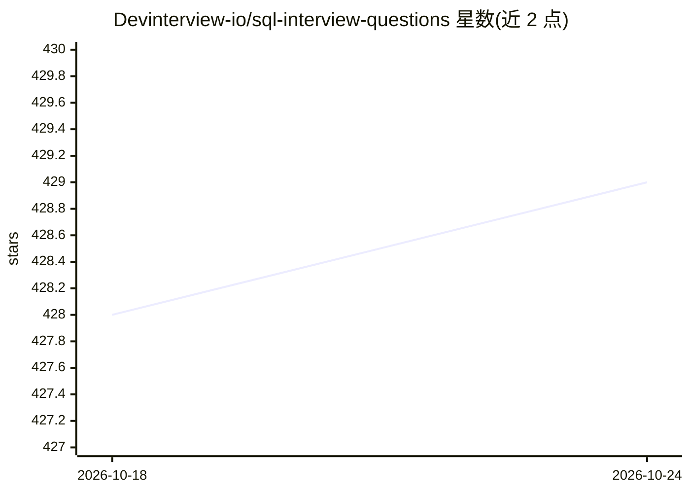

# Devinterview-io/sql-interview-questions

⭐ 429 · 推送 2026-03-13 · [GitHub](https://github.com/Devinterview-io/sql-interview-questions) · 组织维护

**面向数据科学与机器学习面试的 SQL 面试题答案知识库**

Devinterview.io 维护的 SQL 面试问答仓库，收录 100 道 2026 年口径的 SQL 面试题及答案，内容覆盖 SQL 基础概念、SQL 与 NoSQL 架构对比、命令分类（DDL/DML/DCL/TCL/DQL）、SELECT 语句执行顺序等，并纳入 JSONB、pgvector 向量检索、分布式 SQL 等现代特性。全部答案托管在 Devinterview.io 站点，仓库本身以 Markdown 文档形式组织，面向准备数据科学/机器学习岗位面试的求职者，无可安装代码。

## 筛选速览

| 维度 | 判定 | 备注 |
|---|---|---|
| AI 角色 | `ai-knowledge` | 知识聚合/清单类 |
| 许可风险 | `none` | — |
| 部署形态 | `None` |  |
| 模型依赖 | — | README 未给出锁定关系 |
| 硬件要求 | — | 无带数字的原话,不猜 |
| 安装摩擦 | `low` | 无编译、无系统依赖或容器化 |
| 成熟度 | — | 结构信号不足 |

## 能力要点

- 100 道 SQL 面试问答，答案托管于 Devinterview.io
- 覆盖 SQL/NoSQL 架构对比与命令五大分类
- 纳入 2026 年特性：pgvector 向量检索、JSONB、分布式 SQL

## 适用场景

- 准备数据科学/机器学习岗位的 SQL 面试
- 系统复习 SQL 命令分类与执行顺序等基础知识
- 了解现代数据库的向量检索与半结构化数据特性

## 场景标签

`教程课程` · 领域:学习与行业

## 证据(README 行号)

> L1: # 100 Must-Know SQL Interview Questions in 2026
> L7: #### You can also find all 100 answers here 👉 Devinterview.io - SQL

## 星数曲线

2026-10-18 428 → 2026-10-24 429（+1）

---
*卡片 v1 · prompt 1.4 · 生成 2026-10-21 · 置信度 high · 依据 README sha `edd27a8cdc4d` · [字段定义](../../DATASET.md)*
