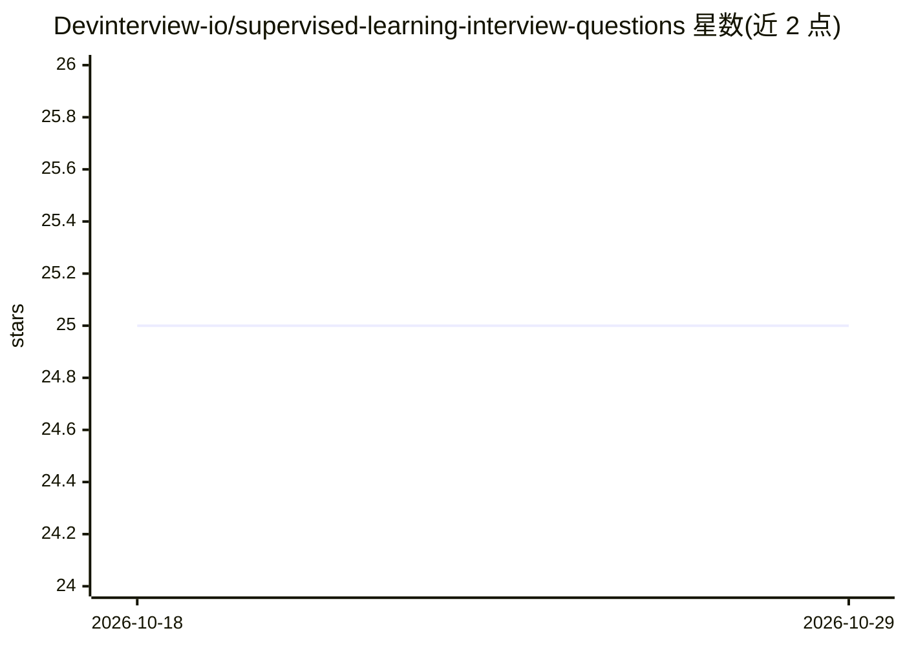

# Devinterview-io/supervised-learning-interview-questions

⭐ 25 · 推送 2026-01-04 · [GitHub](https://github.com/Devinterview-io/supervised-learning-interview-questions) · 组织维护

**监督学习面试题库：70 道题与答案助你准备 ML 面试**

Devinterview.io 维护的监督学习面试问答集合，收录 70 道基础题目，覆盖监督学习定义、与无监督学习的区别、可解决的问题类型（分类、回归、异常检测、时序预测、NLP、目标检测、推荐系统、生成模型）等。答案在 devinterview.io 网站完整提供，仓库内展示部分问题详解并附 scikit-learn 代码示例。面向准备机器学习与数据科学面试的求职者，以 Markdown 阅读为主，无需安装。

## 筛选速览

| 维度 | 判定 | 备注 |
|---|---|---|
| AI 角色 | `ai-knowledge` | 知识聚合/清单类 |
| 许可风险 | `none` | — |
| 部署形态 | `None` |  |
| 模型依赖 | — | README 未给出锁定关系 |
| 硬件要求 | — | 无带数字的原话,不猜 |
| 安装摩擦 | `low` | 无编译、无系统依赖或容器化 |
| 成熟度 | — | 结构信号不足 |

## 能力要点

- 70 道监督学习面试题与答案（完整答案在 devinterview.io）
- 覆盖分类/回归/异常检测/时序/NLP/目标检测等任务类型的算法清单
- 部分问题附 scikit-learn Python 代码示例

## 适用场景

- 准备机器学习/数据科学岗位面试
- 系统复习监督学习概念与常见算法
- 查找各任务类型对应的主流算法清单

## 场景标签

 · 领域:教育/机器学习知识

## 证据(README 行号)

> L1: # 70 Fundamental Supervised Learning Interview Questions in 2026
> L7: #### You can also find all 70 answers here 👉 Devinterview.io - Supervised Learning

## 星数曲线

2026-10-18 25 → 2026-10-29 25（+0）

---
*卡片 v1 · prompt 1.4 · 生成 2026-10-27 · 置信度 high · 依据 README sha `0e68eaa5e632` · [字段定义](../../DATASET.md)*
