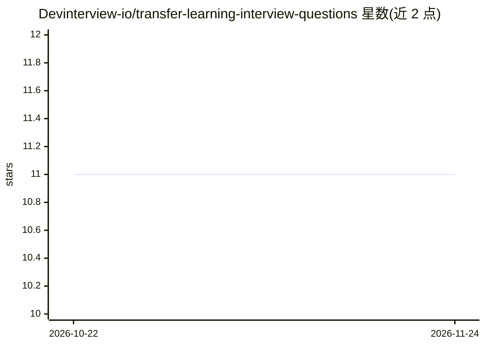

# Devinterview-io/transfer-learning-interview-questions

⭐ 11 · 推送 2026-01-04 · [GitHub](https://github.com/Devinterview-io/transfer-learning-interview-questions) · 组织维护

**机器学习求职者的迁移学习面试题与答案集（38 题）**

Devinterview.io 维护的迁移学习面试准备材料，收录 38 个面试问题并给出答案，内容涵盖迁移学习与传统机器学习的区别、domain/task 概念、domain adaptation 与 task adaptation、优缺点与适用场景、transductive 与 inductive 迁移学习的差异、negative transfer 等概念，并引用 BERT、YOLO 等预训练模型作为应用示例。完整答案托管在 Devinterview.io 网站上，面向准备机器学习与数据科学面试的求职者。

## 筛选速览

| 维度 | 判定 | 备注 |
|---|---|---|
| AI 角色 | `ai-knowledge` | 知识聚合/清单类 |
| 许可风险 | `none` | — |
| 部署形态 | `None` |  |
| 模型依赖 | — | README 未给出锁定关系 |
| 硬件要求 | — | 无带数字的原话,不猜 |
| 安装摩擦 | `low` | 无编译、无系统依赖或容器化 |
| 成熟度 | — | 结构信号不足 |

## 能力要点

- 38 个迁移学习面试问题及答案
- 覆盖 domain adaptation、task adaptation、negative transfer 等概念
- 提供传统 ML 与迁移学习的多维度对比
- 答案集中在 Devinterview.io 网站

## 适用场景

- 准备机器学习/数据科学岗位的面试
- 复习迁移学习的核心概念与术语
- 自查对迁移学习适用场景的理解

## 场景标签

`教程课程` · 领域:学习与行业

## 证据(README 行号)

> L1: # 38 Must-Know Transfer Learning Interview Questions in 2026
> L7: #### You can also find all 38 answers here 👉 Devinterview.io - Transfer Learning

## 星数曲线

2026-10-22 11 → 2026-11-24 11（+0）

---
*卡片 v1 · prompt 1.4 · 生成 2026-11-19 · 置信度 high · 依据 README sha `cada441e4ba8` · [字段定义](../../DATASET.md)*
