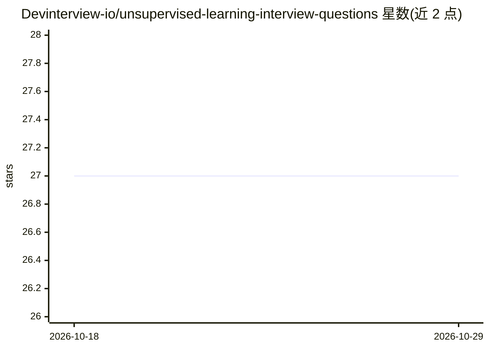

# Devinterview-io/unsupervised-learning-interview-questions

⭐ 27 · 推送 2026-01-04 · [GitHub](https://github.com/Devinterview-io/unsupervised-learning-interview-questions) · 组织维护

**无监督学习面试题与答案合集（55 题，2026）**

Devinterview.io 维护的无监督学习面试准备资料仓库：收录 55 道面试题，每题附答案、关键概念区分、数学公式与 Python/sklearn 代码示例（如 PCA、K-Means、GMM）。内容覆盖聚类、关联、异常检测、降维等主题，README 中列出前数题全文，全部答案指向 devinterview.io 网站查看。面向准备机器学习与数据科学面试的求职者，属纯知识内容仓库，无安装或运行组件。

## 筛选速览

| 维度 | 判定 | 备注 |
|---|---|---|
| AI 角色 | `ai-knowledge` | 知识聚合/清单类 |
| 许可风险 | `none` | — |
| 部署形态 | `None` |  |
| 模型依赖 | — | README 未给出锁定关系 |
| 硬件要求 | — | 无带数字的原话,不猜 |
| 安装摩擦 | `low` | 无编译、无系统依赖或容器化 |
| 成熟度 | — | 结构信号不足 |

## 能力要点

- 55 道无监督学习面试题，含答案与公式
- 附 Python/sklearn 代码示例（PCA、K-Means、GMM）
- 覆盖聚类、降维、异常检测、软/硬聚类等主题

## 适用场景

- 准备机器学习/数据科学岗位面试
- 复习无监督学习核心概念与算法
- 查阅聚类与降维的代码实现示例

## 场景标签

`教程课程` · 领域:学习与行业

## 证据(README 行号)

> L1: # 55 Fundamental Unsupervised Learning Interview Questions in 2026
> L7: #### You can also find all 55 answers here 👉 Devinterview.io - Unsupervised Learning

## 星数曲线

2026-10-18 27 → 2026-10-29 27（+0）

---
*卡片 v1 · prompt 1.4 · 生成 2026-10-26 · 置信度 high · 依据 README sha `69975d12f100` · [字段定义](../../DATASET.md)*
