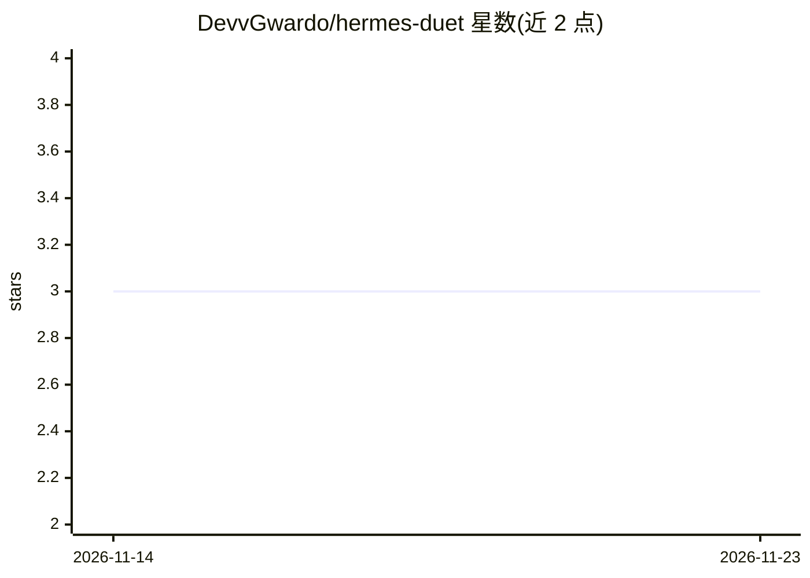

# DevvGwardo/hermes-duet

⭐ 3 · TypeScript · MIT · 推送 2026-11-20 · [GitHub](https://github.com/DevvGwardo/hermes-duet) · [官网](https://devvgwardo.github.io/hermes-duet/) · 个人维护

**为 Hermes agent 提供主动式手机助手：单线程、晨报与审批卡**

一个自托管的 PWA 手机助手前端与 Bun 服务器，连接本地运行的 Hermes agent 网关：聊天、工具活动与卡片在同一会话线程中呈现，支持按定时发送晨报与签到、后台任务独立会话运行、敏感操作经结构化审批卡确认、支付走单次虚拟卡网关。语音经 whisper.cpp 在本机转录，附件可交由视觉模型读取。依赖 Hermes 网关的 API server，macOS 支持原生连接器，Linux/Windows/Docker 部署见部署文档。

## 筛选速览

| 维度 | 判定 | 备注 |
|---|---|---|
| AI 角色 | `ai-native` | 本体是模型或模型工具 |
| 许可风险 | `permissive` | MIT |
| 部署形态 | `None` |  |
| 模型依赖 | — | README 未给出锁定关系 |
| 硬件要求 | — | 无带数字的原话,不猜 |
| 安装摩擦 | `medium` | 含编译或系统依赖之一 |
| 成熟度 | — | 结构信号不足 |

## 能力要点

- Approve / Not now 审批卡机制，出站文本在本机扫描密钥与敏感信息
- 晨报、签到与 Web Push 通知，含静音时段排队合并逻辑
- 后台任务以独立 Hermes 会话运行，支持中途转向与重启恢复
- whisper.cpp 本机离线语音转录；MCP shim 提供 request_approval 等工具

## 适用场景

- 通过消息把工作交给本地 Hermes agent，并在手机上接收晨报与提醒
- 对发消息、付款、删除等敏感 agent 操作逐一审批
- 把研究报告、仪表盘等大任务放到后台运行
- 用语音或拍照方式向 agent 提交收据、白板与表单

## 场景标签

`AI 助手` `语音识别` · 领域:对话与助手

## 证据(README 行号)

> L3:  Hand work to your Hermes agent by message. It works on your machine, asks before anything sensitive, sends you a mo
> L42: - **Duet server** (Bun and SQLite, no framework) serves the PWA and keeps the thread. It drives Hermes through the

## 星数曲线

2026-11-14 3 → 2026-11-23 3（+0）

---
*卡片 v1 · prompt 1.4 · 生成 2026-11-22 · 置信度 mid · 依据 README sha `486a934d108b` · [字段定义](../../DATASET.md)*
