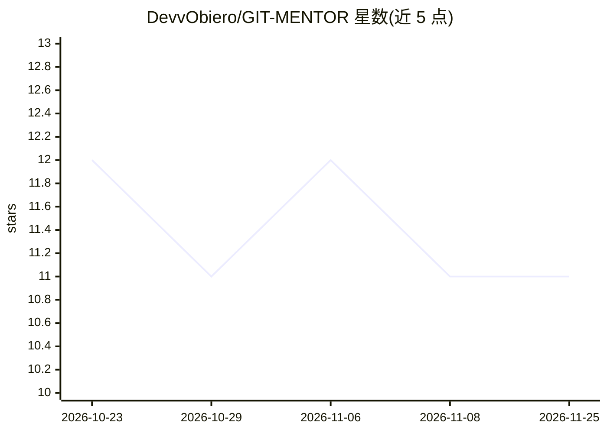

# DevvObiero/GIT-MENTOR

⭐ 11 · JavaScript · 推送 2026-01-24 · [GitHub](https://github.com/DevvObiero/GIT-MENTOR) · [官网](https://git-mentorrr.vercel.app/) · 个人维护

**给开发者分析 GitHub 统计并提供改进建议的工具**

GitHub Mentor 分析指定 GitHub 用户名的公开统计数据（stars、pull requests、issues、commits 等），给出成长等级评分（A、B+、C 等）并生成个性化改进建议，例如距离升级还差多少 PR、需获取多少 star 以提升可见度。面向准备求职的学生、初学者和开源贡献者。技术栈为 React + TailwindCSS，统计数据来源于 GitHub Readme Stats；Node.js + Express 后端标注为即将推出，进度追踪功能亦标注为即将推出，demo 尚未提供。

## 筛选速览

| 维度 | 判定 | 备注 |
|---|---|---|
| AI 角色 | `ai-native` | 本体是模型或模型工具 |
| 许可风险 | `none` | — |
| 部署形态 | `None` |  |
| 模型依赖 | — | README 未给出锁定关系 |
| 硬件要求 | — | 无带数字的原话,不猜 |
| 安装摩擦 | `low` | 无编译、无系统依赖或容器化 |
| 成熟度 | `idea` | |

## 能力要点

- 实时分析任意 GitHub 用户名的统计数据
- 输出成长等级评分（A、B+、C 等）
- 生成个性化改进建议（如差 7 个 PR 升级）
- 数据源为 GitHub Readme Stats

## 适用场景

- 准备实习前优化自己的 GitHub 主页数据
- 初学者按建议补充作品集与贡献记录
- 开源贡献者确定下一步提升方向

## 场景标签

 · 领域:开发者工具/代码托管分析

## 证据(README 行号)

> L2: **GitHub Mentor** is a tool that analyzes your GitHub profile and provides personalized, actionable advice to help y
> L35: - 🧠 Receive personalized tips to level up

## 星数曲线

2026-10-23 12 → 2026-11-25 11（-1）

---
*卡片 v1 · prompt 1.4 · 生成 2026-11-19 · 置信度 mid · 依据 README sha `d26696293c4d` · [字段定义](../../DATASET.md)*
