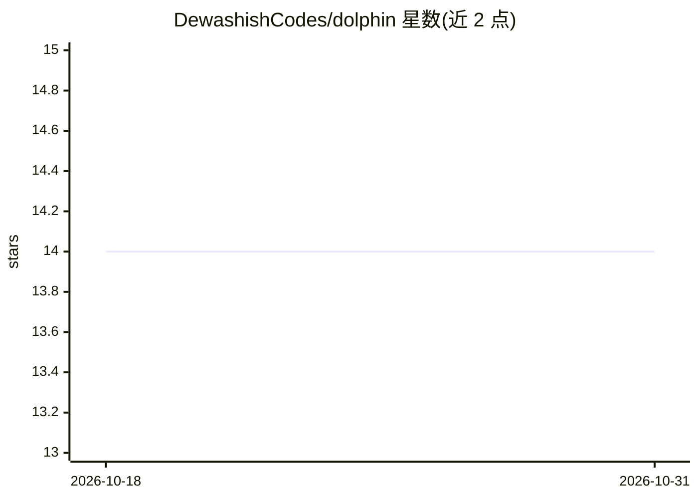

# DewashishCodes/dolphin

⭐ 14 · Python · MIT · 推送 2026-10-08 · [GitHub](https://github.com/DewashishCodes/dolphin) · [官网](https://youtu.be/9d-1TUyvZTA) · 个人维护

**给 LLM 应用与 AI Agent 的持久化图谱记忆层**

提供 Python SDK（add/search/get_context）与 MCP server + Claude Code 插件两种使用方式：前者为应用用户按 user_id 命名空间存取记忆，后者让同一项目的多个 agent 会话共享记忆。机制上结合向量检索与知识图谱：LLM 后台抽取三元组合并成图，混合召回（相似记忆→图节点→一跳扩展），并提供 consolidate 去重。默认全本地运行（SQLite + ONNX 嵌入 + Ollama 抽取），可选 Supabase 后端与 Gemini/OpenAI 抽取；v0.2.0 尚未发布到 PyPI，需从源码安装。

## 筛选速览

| 维度 | 判定 | 备注 |
|---|---|---|
| AI 角色 | `ai-ecosystem` | LLM/agent 周边工具 |
| 许可风险 | `permissive` | MIT |
| 部署形态 | `library` | 以包/库形式分发 |
| 模型依赖 | local-ok | 支持本地模型 |
| 硬件要求 | — | 无带数字的原话,不猜 |
| 安装摩擦 | `low` | 无编译、无系统依赖或容器化 |
| 成熟度 | `idea` | |

## 能力要点

- 向量检索 + 知识图谱的混合召回
- 默认全本地：SQLite + ONNX 嵌入模型 + Ollama 抽取
- MCP server 与 Claude Code 插件实现跨会话共享记忆
- 提供 remember/recall/search/forget 等工具与 CLI

## 适用场景

- 为我的 LLM 应用加按用户隔离的持久记忆
- 让 Claude Code 多个会话共享同一项目的决策与约定
- 本地部署无需账号的记忆层，并可选 Supabase 上服务端

## 场景标签

`Agent 记忆` · 领域:Agent 开发

## 证据(README 行号)

> L6: Dolphin is a memory layer that combines **vector search** with a **knowledge graph**.
> L83: Everything runs locally by default: SQLite for storage, an ONNX embedding model, and Ollama for extraction. Gemini 

## 星数曲线

2026-10-18 14 → 2026-10-31 14（+0）

---
*卡片 v1 · prompt 1.4 · 生成 2026-10-31 · 置信度 high · 依据 README sha `f8b743ec45c1` · [字段定义](../../DATASET.md)*
