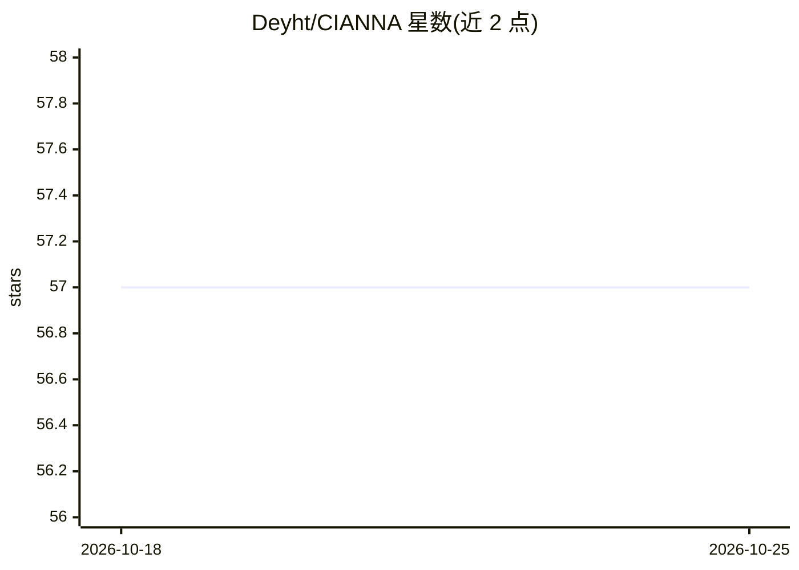

# Deyht/CIANNA

⭐ 57 · C · Apache-2.0 · 推送 2026-06-05 · [GitHub](https://github.com/Deyht/CIANNA) · 组织维护

**面向天体物理的 GPU 深度学习框架，含射电星系检测**

通用深度学习框架，主要面向天文数据分析开发，提供类 Keras/PyTorch 的高层 Python 接口，可构建与训练大型神经网络模型，通过底层 CUDA 编程实现全 GPU 加速。特色是 YOLO 风格的定制目标检测器，用于 2D/3D 射电天文数据中的星系检测；示例覆盖 MNIST/ImageNet 分类、COCO 检测、SKA 射电源检测、银河系消光回归与基于级联 DDPM 的星系生成。由巴黎天文台团队维护，Apache2 许可，提供 Dockerfile 安装器与实验分支。

## 筛选速览

| 维度 | 判定 | 备注 |
|---|---|---|
| AI 角色 | `ai-ecosystem` | LLM/agent 周边工具 |
| 许可风险 | `permissive` | Apache-2.0 |
| 部署形态 | `self-host` | docker 或自建部署 |
| 模型依赖 | — | README 未给出锁定关系 |
| 硬件要求 | — | 无带数字的原话,不猜 |
| 安装摩擦 | `low` | 无编译、无系统依赖或容器化 |
| 成熟度 | — | 结构信号不足 |

## 能力要点

- 2D/3D 射电天文数据中的 YOLO 风格目标检测器
- 底层 CUDA 编程实现全 GPU 加速（FP16C_FP32A 混合精度）
- 高层 Python 接口，类 Keras/PyTorch 使用方式
- 示例含级联 DDPM 星系图像生成（实验分支）

## 适用场景

- 射电巡天数据（如 SKA）中做射电源检测
- 天文图像的分类、回归与生成任务建模
- 需要 GPU 加速训练的通用卷积网络研究

## 场景标签

`目标检测` `模型训练` · 领域:感知与多模态

## 证据(README 行号)

> L26: CIANNA is a general-purpose deep learning framework primarily developed and used for astronomical data analysis. Fu
> L29: David Cornu - creator and lead dev, post-doc researcher, AI Fellow PR[AI]RIE, FR - LUX / Observatoire de Paris, PSL

## 星数曲线

2026-10-18 57 → 2026-10-25 57（+0）

---
*卡片 v1 · prompt 1.4 · 生成 2026-10-24 · 置信度 high · 依据 README sha `fd95aaf94856` · [字段定义](../../DATASET.md)*
