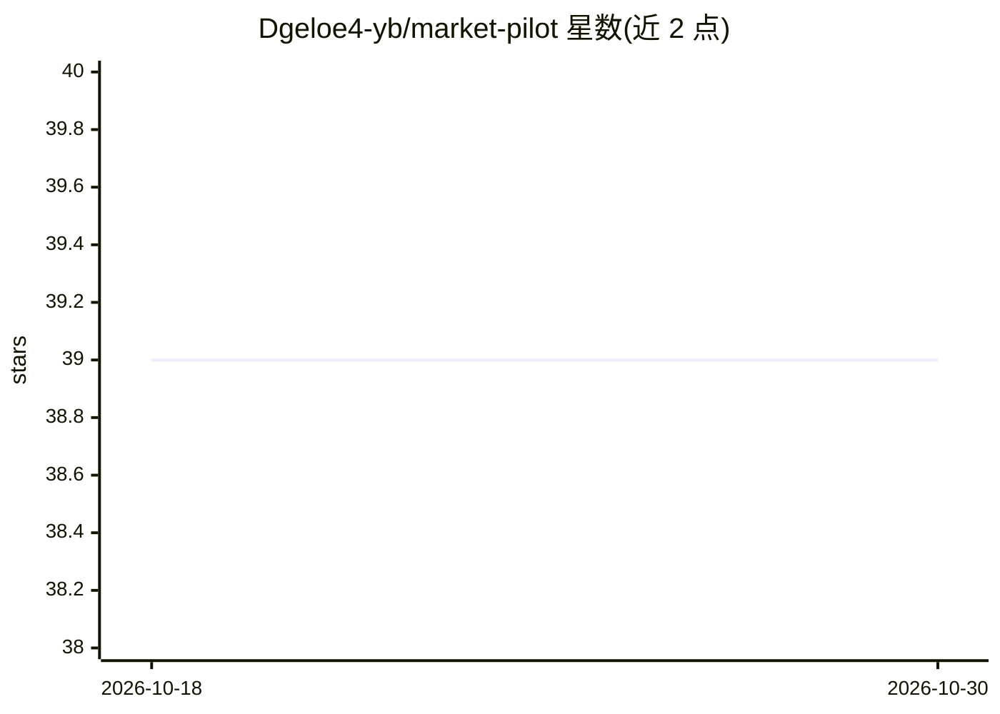

# Dgeloe4-yb/market-pilot

⭐ 39 · JavaScript · Apache-2.0 · 推送 2026-08-06 · [GitHub](https://github.com/Dgeloe4-yb/market-pilot) · [官网](https://marketpilot.worldon.ai/) · 个人维护 · 中文 README

**证据可溯源的市场研究原型：公开信号转为可核查报告**

React 前端加 FastAPI 后端的市场研究产品原型：从收集的公开信号构建研究面板，生成去标识化的 persona 卡片，通过证据感知的提示词回答研究问题，并汇总共识、分歧、限制与支撑信号。工作流强调区分直接证据与推断、遮蔽个人标识、在报告中呈现不确定性，支持英文与简体中文双语切换及本地化报告缓存。模型相关运行与数据连接器需用户自备授权的 provider 凭据，示例数据须标注为脱敏数据。

## 筛选速览

| 维度 | 判定 | 备注 |
|---|---|---|
| AI 角色 | `ai-native` | 本体是模型或模型工具 |
| 许可风险 | `permissive` | Apache-2.0 |
| 部署形态 | `desktop` | 安装包/桌面程序 |
| 模型依赖 | — | README 未给出锁定关系 |
| 硬件要求 | — | 无带数字的原话,不猜 |
| 安装摩擦 | `low` | 无编译、无系统依赖或容器化 |
| 成熟度 | `idea` | |

## 能力要点

- 从公开信号构建研究面板并生成去标识化 persona 卡片
- 证据感知提示词路由与回答，区分直接证据与推断
- 汇总共识、分歧、限制与支撑信号
- React/FastAPI 双栈，英文与简体中文双语界面

## 适用场景

- 把公开市场讨论整理为可溯源的研究报告
- 生成脱敏 persona 卡片用于用户研究
- 查看共识与分歧的支撑证据与不确定性

## 场景标签

`科研工具` · 领域:学习与行业

## 证据(README 行号)

> L3: Market Pilot is an evidence-grounded market research prototype that turns public market signals into traceable resea
> L15: - Route and answer research questions through evidence-aware prompts.
> L28: - Research pipeline: collection, masking, panel construction, evidence-aware answering, aggregation, and report ren

## 星数曲线

2026-10-18 39 → 2026-10-30 39（+0）

---
*卡片 v1 · prompt 1.4 · 生成 2026-10-25 · 置信度 mid · 依据 README sha `2c9931d3e048` · [字段定义](../../DATASET.md)*
