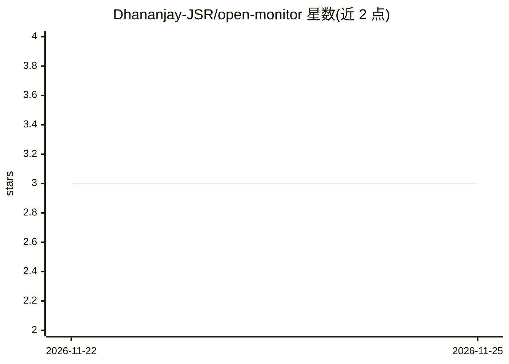

# Dhananjay-JSR/open-monitor

⭐ 3 · JavaScript · MIT · 推送 2026-11-18 · [GitHub](https://github.com/Dhananjay-JSR/open-monitor) · [官网](https://omon.dhananjaay.dev) · 个人维护

**自托管网页监控服务：LLM 过滤搜索与页面变化并推送 webhook**

自托管 Node 服务，按计划运行两类监控：搜索监控执行查询并筛选结果，页面监控抓取 URL 并与上次快照做文本 diff；每个候选结果由一次 LLM 调用按监控目标打 0-1 分，达到阈值（默认 0.5）的事件以 Standard Webhooks 方式签名推送到 webhook。提供 dashboard、OpenAPI 3.1 接口、OpenTelemetry 导出，部署方式覆盖 Node 直接运行、Docker Compose（含 SearXNG 与 Lightpanda）、Render/Railway 与 Cloudflare Workers（D1 存储，无 LLM_COMMAND）。无 LLM 时所有运行判定为 judge_failed。

## 筛选速览

| 维度 | 判定 | 备注 |
|---|---|---|
| AI 角色 | `ai-native` | 本体是模型或模型工具 |
| 许可风险 | `permissive` | MIT |
| 部署形态 | `self-host` | docker 或自建部署 |
| 模型依赖 | locked-api |  |
| 硬件要求 | — | 无带数字的原话,不猜 |
| 安装摩擦 | `low` | 无编译、无系统依赖或容器化 |
| 成熟度 | — | 结构信号不足 |

## 能力要点

- 搜索与页面两类监控，LLM 按 goal 打分过滤（阈值可配）
- Webhook 事件按 Standard Webhooks 签名，含重试与配对签名轮换机制
- OpenAI 兼容 LLM 接口，支持本地命令（LLM_COMMAND）替代，默认走 OpenRouter 免费模型并共享速率限制
- Docker Compose 全栈内置 SearXNG 搜索与 Lightpanda 浏览器

## 适用场景

- 定时监控特定主题的搜索结果并只推送相关项
- 跟踪网页内容变化并将 diff 交由 LLM 判定重要性
- 自托管部署（含 Cloudflare Workers）接收签名 webhook 做后续自动化

## 场景标签

`网页抓取` `工作流自动化` · 领域:效率与自动化

## 证据(README 行号)

> L5: A self-hosted server that watches web searches or specific pages on a schedule, asks an LLM whether each new result 
> L71: |`LLM_API_KEY`, `LLM_BASE_URL`, `LLM_MODEL`|Judge over an OpenAI-compatible API. Defaults: OpenRouter, model `openr
> L86: Each candidate (a new search result, or a page diff) gets one LLM call that scores it from 0 to 1 against the monit

## 星数曲线

2026-11-22 3 → 2026-11-25 3（+0）

---
*卡片 v1 · prompt 1.4 · 生成 2026-11-22 · 置信度 high · 依据 README sha `e8a665788575` · [字段定义](../../DATASET.md)*
