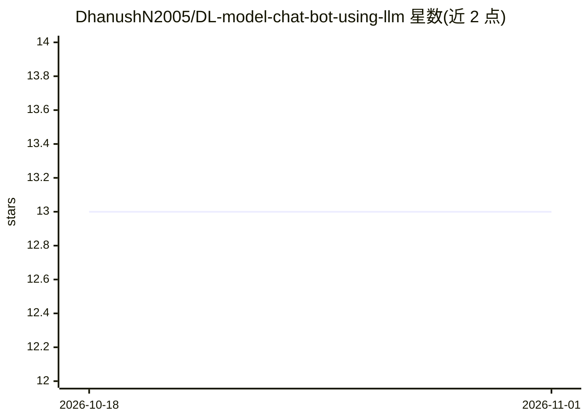

# DhanushN2005/DL-model-chat-bot-using-llm

⭐ 13 · Python · 推送 2026-01-22 · [GitHub](https://github.com/DhanushN2005/DL-model-chat-bot-using-llm) · 个人维护

**基于深度学习的 Python 入门级聊天机器人脚本**

一个简单的 Python 聊天机器人项目，核心为 chatbot.py 脚本，使用深度学习或简单逻辑与用户交互，另有示例/测试文件（需重命名为 .py）。README 要求 Python 3.7+，示例依赖安装命令列出 numpy、tensorflow、nltk，通过 python chatbot.py 直接运行。README 自述依赖与说明需按实际代码更新，测试文件命名也待整理，文档与代码均处于基础/未完善状态。

## 筛选速览

| 维度 | 判定 | 备注 |
|---|---|---|
| AI 角色 | `ai-native` | 本体是模型或模型工具 |
| 许可风险 | `none` | — |
| 部署形态 | `library` | 以包/库形式分发 |
| 模型依赖 | — | README 未给出锁定关系 |
| 硬件要求 | — | 无带数字的原话,不猜 |
| 安装摩擦 | `low` | 无编译、无系统依赖或容器化 |
| 成熟度 | — | 结构信号不足 |

## 能力要点

- 单脚本 chatbot.py 实现深度学习聊天机器人
- 提供示例/测试脚本验证聊天回复
- 示例依赖列出 numpy、tensorflow、nltk

## 适用场景

- 学习深度学习聊天机器人的基础实现
- 在此基础上修改扩展自己的对话逻辑

## 场景标签

`聊天机器人` · 领域:对话与助手

## 证据(README 行号)

> L3: A simple deep learning based chatbot project in Python.
> L6: This repository contains a basic chatbot Python script that uses deep learning or simple logic to interact with user

## 星数曲线

2026-10-18 13 → 2026-11-01 13（+0）

---
*卡片 v1 · prompt 1.4 · 生成 2026-10-31 · 置信度 low · 依据 README sha `57381412fe07` · [字段定义](../../DATASET.md)*
