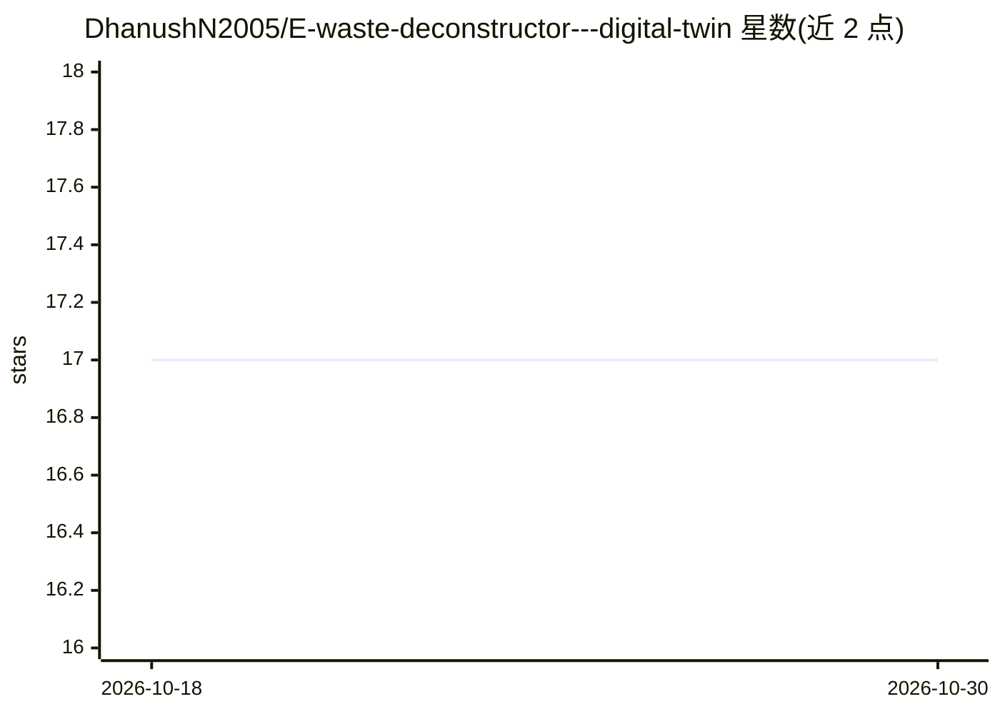

# DhanushN2005/E-waste-deconstructor---digital-twin

⭐ 17 · Python · 推送 2026-02-26 · [GitHub](https://github.com/DhanushN2005/E-waste-deconstructor---digital-twin) · 个人维护

**电子垃圾分类与危险等级预测的数字孪生系统**

面向电子废弃物处理的计算机视觉系统：使用 YOLO 目标检测识别并分类电子垃圾组件，预测检测物品的危险等级，并自动生成安全拆解建议；配套数字孪生模块自主模拟并实时监控拆解流程，另含 HTML 网页仪表盘展示检测与仿真状态。README 未给出安装命令、依赖清单或运行说明，仓库结构以图片形式呈现，无法核验代码入口。

## 筛选速览

| 维度 | 判定 | 备注 |
|---|---|---|
| AI 角色 | `ai-native` | 本体是模型或模型工具 |
| 许可风险 | `none` | — |
| 部署形态 | `None` |  |
| 模型依赖 | — | README 未给出锁定关系 |
| 硬件要求 | — | 无带数字的原话,不猜 |
| 安装摩擦 | `low` | 无编译、无系统依赖或容器化 |
| 成熟度 | — | 结构信号不足 |

## 能力要点

- YOLO 目标检测识别并分类电子垃圾组件
- 危险等级预测与自动化安全拆解建议生成
- 数字孪生自主模拟拆解流程并实时监控
- HTML 网页仪表盘展示检测与仿真状态

## 适用场景

- 识别电子废弃物类别以辅助分拣
- 评估废弃电子元件的危险等级
- 在仿真环境中监控拆解流程

## 场景标签

`目标检测` · 领域:感知与多模态

## 证据(README 行号)

> L6: A smart, automated e-waste processing system that uses computer vision and digital twin simulation to classify elect
> L16: - 🔍 **YOLO-powered Object Detection**

## 星数曲线

2026-10-18 17 → 2026-10-30 17（+0）

---
*卡片 v1 · prompt 1.4 · 生成 2026-10-30 · 置信度 high · 依据 README sha `6914a19efc05` · [字段定义](../../DATASET.md)*
