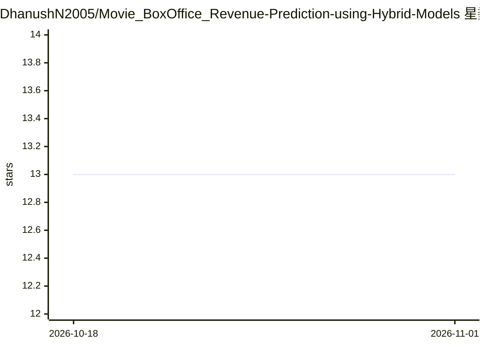

# DhanushN2005/Movie_BoxOffice_Revenue-Prediction-using-Hybrid-Models

⭐ 13 · HTML · 推送 2026-01-09 · [GitHub](https://github.com/DhanushN2005/Movie_BoxOffice_Revenue-Prediction-using-Hybrid-Models) · 个人维护

**电影上映前预测票房收入的机器学习项目**

基于历史数据与影片元数据（预算、类型、演员、上映日期等）预测票房收入的机器学习仓库，包含数据处理、特征工程、多模型训练与评估脚本。特征工程含类型编码、预算缩放与时间特征（上映月份、假期效应）；训练并比较线性回归、随机森林、梯度提升及可选的 XGBoost/LightGBM 模型，以 RMSE/MAE 与交叉验证进行模型对比。面向制片人、分析师与电影行业相关人员，通过 git clone 源码方式获取运行。

## 筛选速览

| 维度 | 判定 | 备注 |
|---|---|---|
| AI 角色 | `ai-native` | 本体是模型或模型工具 |
| 许可风险 | `none` | — |
| 部署形态 | `None` |  |
| 模型依赖 | — | README 未给出锁定关系 |
| 硬件要求 | — | 无带数字的原话,不猜 |
| 安装摩擦 | `low` | 无编译、无系统依赖或容器化 |
| 成熟度 | — | 结构信号不足 |

## 能力要点

- 基于预算、类型、演员、上映日期等特征预测票房
- 特征工程含类型编码、预算缩放与时间特征
- 训练并比较线性回归/随机森林/梯度提升等多种模型
- 以 RMSE/MAE 与交叉验证评估模型

## 适用场景

- 影片上映前估算票房收入
- 分析影响票房的关键特征
- 比较不同回归模型在该任务上的表现

## 场景标签

 · 领域:机器学习/娱乐数据分析

## 证据(README 行号)

> L3: A machine learning project that predicts the **box office revenue** of movies using historical and movie metadata.
> L12: ✔ Compare multiple ML models to find the best performer

## 星数曲线

2026-10-18 13 → 2026-11-01 13（+0）

---
*卡片 v1 · prompt 1.4 · 生成 2026-10-31 · 置信度 high · 依据 README sha `08183338b4a3` · [字段定义](../../DATASET.md)*
