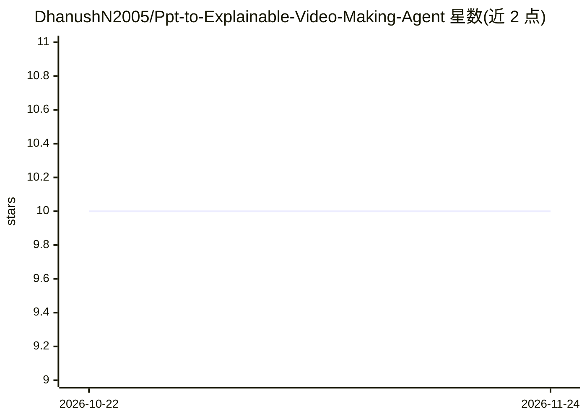

# DhanushN2005/Ppt-to-Explainable-Video-Making-Agent

⭐ 10 · Python · 推送 2026-01-09 · [GitHub](https://github.com/DhanushN2005/Ppt-to-Explainable-Video-Making-Agent) · 个人维护

**把 PPT 幻灯片自动转成带旁白/文字说明视频的工具**

该项目是一个将 .ppt/.pptx 幻灯片转换为视频的应用：把每张幻灯片渲染为视频帧，添加语音旁白（文本转语音）或文字叠加说明，提供从幻灯片到讲解视频的流程。由 Python 后端代码与 HTML/CSS 模板 UI 组成；AI 旁白/讲解生成为可选项（需配置），未配置时仍可完成转换流程。README 给出通过 git clone 获取源码的本地安装步骤。

## 筛选速览

| 维度 | 判定 | 备注 |
|---|---|---|
| AI 角色 | `ai-enhanced` | 去掉 AI 部分产品仍成立 |
| 许可风险 | `none` | — |
| 部署形态 | `None` |  |
| 模型依赖 | — | README 未给出锁定关系 |
| 硬件要求 | — | 无带数字的原话,不猜 |
| 安装摩擦 | `low` | 无编译、无系统依赖或容器化 |
| 成熟度 | — | 结构信号不足 |

## 能力要点

- 将每张幻灯片转换为视频帧
- 支持文本转语音（TTS）旁白或文字叠加
- AI 旁白/讲解生成为可配置的可选功能
- 接受 .ppt 与 .pptx 输入文件

## 适用场景

- 把课程讲义 PPT 快速转成带旁白的讲解视频
- 为演示幻灯片批量生成视频版本
- 以最少手工操作生成讲解型演示视频

## 场景标签

`语音合成` `视频生成` · 领域:内容生成

## 证据(README 行号)

> L13: ✔ Supporting AI-based narration through text-to-speech (if configured)
> L20: - 🧠 **AI/ML (optional)** – For enhanced narration or explanation generation

## 星数曲线

2026-10-22 10 → 2026-11-24 10（+0）

---
*卡片 v1 · prompt 1.4 · 生成 2026-11-20 · 置信度 mid · 依据 README sha `262f63481c3d` · [字段定义](../../DATASET.md)*
